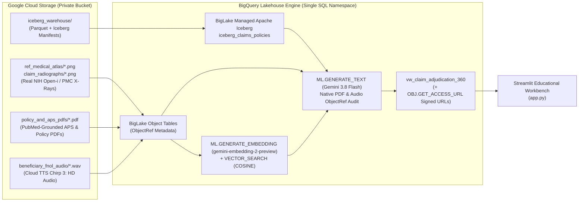

# 🛡️ OmniClaim Life Lakehouse: Multi-Modal Life & Living Benefits Claims Adjudication on Google Cloud

[](https://www.python.org/)
[](https://cloud.google.com/bigquery)
[](https://iceberg.apache.org/)
[](https://cloud.google.com/vertex-ai)

**OmniClaim Life Lakehouse** is an open-source reference architecture and educational Proof-of-Concept (POC) demonstrating how **Google Cloud Lakehouse** unifies structured actuarial/policy records, **real peer-reviewed clinical radiographs (US NIH National Library of Medicine Open-i / PubMed Central)**, legal contract & physician PDFs, and **recorded beneficiary audio statements (`Google Cloud TTS Chirp 3: HD`)** inside **a single governed BigQuery SQL namespace**—eliminating external vector databases and bespoke OCR/Speech-to-Text ETL pipelines.

---

## 📖 Table of Contents

1. [Why Life Insurance Needs a Multi-Modal Lakehouse](#-why-life-insurance-needs-a-multi-modal-lakehouse)
2. [Architecture & Google Cloud Lakehouse Building Blocks](#-architecture--google-cloud-lakehouse-building-blocks)
3. [The 4-Act Customer Claim Investigation Storyline](#-the-4-act-customer-claim-investigation-storyline)
4. [The 5 Hero Scenarios & Real NIH Clinical Data](#-the-5-hero-scenarios--real-nih-clinical-data)
5. [Quickstart Guide (Local Preview & Google Cloud Deployment)](#-quickstart-guide-local-preview--google-cloud-deployment)
6. [Under the Hood: Core BigQuery Lakehouse SQL Patterns](#-under-the-hood-core-bigquery-lakehouse-sql-patterns)
7. [Interactive Streamlit Workbench (`app.py`)](#-interactive-streamlit-workbench-apppy)
8. [Repository Structure & Automated Verification](#-repository-structure--automated-verification)

---

## 🏗️ Why Life Insurance Needs a Multi-Modal Lakehouse

Unlike high-frequency auto or dental claims, **Life Insurance, Critical Illness (CI) Living Benefits, and Accidental Death & Dismemberment (AD&D)** claims are low-frequency, high-severity events (**$250,000 to $2,000,000+ Sum Assured**). When a claim arrives, an examiner or **Special Investigations Unit (SIU)** investigator cannot rely on structured tabular columns alone—the truth lives across **four distinct data modalities**:

1. **24-Month Contestability Window & Material Misrepresentation (`Iceberg` + `X-Ray` + `APS PDF` + `Audio`)**:
   - Under standard Life Insurance law, if a claim occurs within **24 months of the `issue_date`**, the carrier investigates whether the applicant concealed material pre-existing conditions at underwriting (e.g., applying for *Preferred Plus Non-Smoker* rates while an emergency chest radiograph and Attending Physician Statement [APS] reveal chronic Stage III Cardiomegaly and an implanted biventricular pacemaker).
2. **AD&D Double-Indemnity Rider Exclusions (`Iceberg` + `Trauma X-Ray` + `Policy & Coroner PDFs` + `Audio`)**:
   - Even when a policy is past 24 months (making the **Base Life** benefit incontestable), an **AD&D Rider** ($1M additional accidental death payout) is governed by specific hazardous-activity exclusions (e.g., *Section 4.2(a) excluding unroped free-solo alpine climbing above 4,000 meters*) that must be cross-checked against medical examiner trauma reports and recorded beneficiary First Notice of Loss (FNOL) phone calls.
3. **Syndicated Medical Evidence Reuse Fraud (`BigLake Object Tables` + `VECTOR_SEARCH`)**:
   - Fraud rings recycle diagnostic cancer/pathology radiographs across multiple policies, altering a few pixels so traditional `MD5`/`SHA-256` file hash checks fail. In-engine **3072-dimensional vector similarity search (`gemini-embedding-2-preview`)** detects the visual duplicate in milliseconds.

---

## 🏛️ Architecture & Google Cloud Lakehouse Building Blocks

Instead of copying Protected Health Information (PHI) across external OCR microservices, Speech-to-Text pipelines, and third-party vector databases, every structured and unstructured asset stays inside a single private Google Cloud Storage bucket (`--public-access-prevention`) and is governed directly by **BigQuery**:



| Lakehouse Layer | Google Cloud Feature | Role in OmniClaim Life Lakehouse |
| :--- | :--- | :--- |
| **1. Open Table Format** | **BigLake Managed Apache Iceberg** (`table_format = 'ICEBERG'`, `file_format = 'PARQUET'`) | Stores structured policy, underwriting declaration, and claim core records as open Parquet + Iceberg metadata manifests in GCS (`gs://<bucket>/iceberg_warehouse/`) with full ACID transactions. |
| **2. Unstructured Governance** | **BigLake Object Tables** (`object_metadata = 'SIMPLE'`) + **`ObjectRef`** | Catalogs raw `.png` radiographs, `.pdf` contracts/physician statements, and `.wav` call recordings in GCS as SQL rows and constructs native `ObjectRef` pointers (`OBJ.MAKE_REF`, `OBJ.FETCH_METADATA`). |
| **3. Visual Forensics** | **`gemini-embedding-2-preview`** + **`VECTOR_SEARCH (COSINE)`** | Generates 3072-dimensional multimodal embeddings over the radiograph Object Tables and computes exact cosine similarity against a Reference Medical & Historical Prior-Claims Atlas. |
| **4. Multimodal Audit** | **Vertex AI `gemini-3.8-flash`** via `ML.GENERATE_TEXT` | Reads multi-page Policy & APS PDFs and listens to `.wav` beneficiary call recordings directly from GCS via `ObjectRef`—synthesizing a structured JSON adjudication verdict inside SQL. |
| **5. Zero-Egress UI Delivery** | **`OBJ.GET_ACCESS_URL(ref, 'r')`** | Generates time-limited signed GCS read URLs on the fly inside the SQL view so the Streamlit UI renders private media without opening bucket permissions. |

---

## 🎬 The 4-Act Customer Claim Investigation Storyline

Every claim in the **OmniClaim Life 360 Workbench (`app.py`)** walks through a progressive **4-Step Investigation Storyline** tracking a single customer from **Policy Issue Date** (when a healthy baseline chest X-ray `REF_NORM_001` from NIH `PMC12127709` was archived) to **Claim Adjudication**:

1. **Step 1 — Policy & Contestability (`BigLake Apache Iceberg`)**: What health class and medical declarations did the customer sign at underwriting, and did the claim occur inside the **24-Month Contestability Window**?
2. **Step 2 — 3-Way Longitudinal X-Ray Vector Search (`BigQuery VECTOR_SEARCH`)**: Visual comparison of **(1) Underwriting Baseline Healthy X-Ray (`REF_NORM_001`)** $\rightarrow$ **(2) Claim Event Emergency X-Ray** $\rightarrow$ **(3) Top-1 BigQuery Vector Atlas Match (`gemini-embedding-2-preview`)**.
3. **Step 3 — Physician APS & Policy Contract Audit (`Gemini 3.8 Flash` + PDF `ObjectRef`)**: Zero-OCR multimodal inspection of the Attending Physician Statement (APS) and Master Policy Wording PDFs.
4. **Step 4 — Recorded FNOL Audio & Final Verdict (`Gemini 3.8 Flash` + Audio `ObjectRef`)**: Native audio cross-examination of the beneficiary's recorded phone call (`Chirp 3: HD` `.wav`) against the structured, visual, and contractual evidence.

---

## 🎯 The 5 Hero Scenarios & Real NIH Clinical Data

All clinical radiographs are downloaded from open-access, peer-reviewed cases in the **US National Institutes of Health (NIH) National Library of Medicine Open-i / PubMed Central & MedPix repository**, and all audio files are synthesized with natural human conversational voices via **Google Cloud Text-to-Speech `Chirp 3: HD`**:

| Claim ID | Insured & Policy Type | Claimed Benefit | Contestability (`months_since_issue`) | Real NIH Open-i / PubMed Central Source & Multi-Modal Evidence | Verdict & Approved Payout |
| :--- | :--- | :--- | :--- | :--- | :--- |
| **`CLM-LIFE-1001`** | **Eleanor Vance**<br>20-Yr Term (`POL-TERM-STD-2025`) | **$500,000**<br>*(Natural Death)* | **68 mos**<br>✅ *Incontestable* | • **NIH Source**: `PMC10405870` (PMID: `37554481` — Acute RLL lobar pneumonia).<br>• **X-Ray Vector**: Matches `REF_PNEUMONIA_001` (`CONSISTENT_ACUTE_OR_TRAUMA_FINDING`).<br>• **APS PDF & Chirp 3 HD Audio (`Aoede`)**: Consistent acute infection after 5+ clean years. | ✅ **`AUTO_APPROVE_PAYOUT`**<br>**$500,000** |
| **`CLM-LIFE-1002`** | **Robert Sterling**<br>Whole Life Preferred+ (`POL-WL-PREF-2025`) | **$1,500,000**<br>*(Cardiac Death)* | **7 mos**<br>⚠️ *Contestable (<24m)* | • **NIH Source**: `PMC7033380` (PMID: `32095464` — Panel A emergency admission vs. Panel B historical film of same pacemaker patient).<br>• **X-Ray Vector**: Matches `REF_CARDIOMEGALY_001` (`0.9355` similarity, `CHRONIC_PRE_EXISTING_CARDIAC_INDICATOR`).<br>• **APS PDF & Chirp 3 HD Audio (`Kore`)**: Spouse admits 4-yr pacemaker & cardiomyopathy history. | 🚨 **`SIU_RESCISSION_HOLD`**<br>**$0** *(Material Misrepresentation)* |
| **`CLM-ADD-1003`** | **Marcus Thorne**<br>Exec Term + AD&D (`POL-ADD-EXEC-2025`) | **$2,000,000**<br>*($1M Base + $1M AD&D)* | **38 mos**<br>✅ *Base Incontestable* | • **NIH Source**: `PMC5702695` (PMID: `29181345` — High-energy displaced mid-shaft clavicle fracture).<br>• **X-Ray Vector**: Matches `REF_TRAUMA_001` (`0.9547` similarity).<br>• **Policy PDF & Chirp 3 HD Audio (`Fenrir`)**: Brother admits insured was *free-solo ice climbing at 4,250m on Mt. Rainier* (violating Section 4.2(a) >4,000m exclusion). | ⚠️ **`PARTIAL_APPROVE_BASE_DENY_ADD_RIDER`**<br>**$1,000,000** *(Base Only)* |
| **`CLM-CI-1004`** | **Victor Krum**<br>Universal Life + CI (`POL-UL-CI-2025`) | **$350,000**<br>*(Critical Illness)* | **14 mos**<br>⚠️ *Contestable (<24m)* | • **NIH Source**: `MedPix MPX1219` (`synpic14404` — LUL Non-Small Cell Lung Cancer mass).<br>• **X-Ray Vector**: **`0.9962` cosine similarity** (`distance = 0.0038`) to `PRIOR_CLM_8821_FRAUD` despite altered SHA-256 hash.<br>• **APS PDF & Chirp 3 HD Audio (`Charon`)**: Unverified clinic; evasive caller refuses to name oncologist. | 🛑 **`SIU_FRAUD_RING_REJECT`**<br>**$0** *(Duplicate X-Ray Fraud)* |
| **`CLM-CI-1005`** | **Diana Chen**<br>Universal Life + CI (`POL-UL-CI-2025`) | **$250,000**<br>*(Critical Illness)* | **29 mos**<br>✅ *Incontestable* | • **NIH Source**: `PMC7529567` (PMID: `32869499` — Solitary 30x20mm RUL primary lung adenocarcinoma).<br>• **X-Ray Vector**: Matches `REF_PULM_MASS_001` (`0.9668` similarity, zero prior-claim match).<br>• **APS PDF & Chirp 3 HD Audio (`Leda`)**: Biopsy confirms Stage IIA pT1cN0M0 adenocarcinoma (>=2.0cm Section 2.1 threshold). | ✅ **`APPROVE_LIVING_BENEFIT`**<br>**$250,000** |

---

## 🚀 Quickstart Guide (Local Preview & Google Cloud Deployment)

### Prerequisites
- **Python 3.12+** and **[`uv`](https://docs.astral.sh/uv/)** package manager
- *(For Google Cloud execution)* **[Google Cloud SDK (`gcloud` & `bq`)](https://cloud.google.com/sdk/docs/install)** authenticated with a billing-enabled GCP project

---

### Option A: Instant Local Preview (< 15 Seconds, Zero GCP Account Required)

The repository includes the pre-fetched NIH Open-i radiographs, PubMed-grounded APS/Policy PDFs, and `Chirp 3: HD` `.wav` recordings in `data/`, so you can launch the interactive workbench immediately:

```bash
# 1. Install dependencies in an isolated virtual environment
uv sync

# 2. (Optional) Re-build all multi-modal files and run the verification test suite
uv run python generate_data.py
uv run python -m pytest -v

# 3. Launch the OmniClaim Life 360 Streamlit Workbench
uv run streamlit run app.py
```

---

### Option B: Full End-to-End Google Cloud Lakehouse Deployment

To provision the **BigLake Managed Apache Iceberg** tables, **BigLake Object Tables**, **`gemini-embedding-2-preview` Vector Search**, and **`gemini-3.8-flash` `ObjectRef` Multimodal SQL** in your own Google Cloud project:

#### 1. Configure Your Environment (`.env`)
Copy `.env.example` to `.env` (which is gitignored) and set your `GCP_PROJECT_ID`:
```bash
cp .env.example .env
```
Edit `.env`:
```dotenv
GCP_PROJECT_ID=your-gcp-project-id
GCP_REGION=us-central1
GCS_BUCKET_NAME=your-gcp-project-id-bucket
BQ_DATASET_ID=omniclaim_lakehouse
BQ_CONNECTION_ID=lakehouse-omniclaim-conn
GEMINI_MODEL_ENDPOINT=gemini-3.8-flash
EMBEDDING_MODEL_ENDPOINT=gemini-embedding-2-preview
```

#### 2. Provision GCP Infrastructure (`setup_gcp.sh`)
Enables the BigQuery, BigLake, Connection, Storage, Vertex AI, and Cloud TTS APIs, creates your private regional GCS bucket (`--public-access-prevention`), creates the BigQuery dataset and Cloud Resource Connection, and grants `roles/storage.objectAdmin` (required for Managed Iceberg Parquet/manifest writes) + `roles/aiplatform.user` to the connection service account:
```bash
bash setup_gcp.sh
```

#### 3. Execute the Multi-Modal Lakehouse Pipeline (`run_lakehouse.py`)
Uploads the 26 unstructured files to GCS, executes [`sql/01_lakehouse_ddl.sql`](sql/01_lakehouse_ddl.sql) and [`sql/02_multimodal_query.sql`](sql/02_multimodal_query.sql), verifies all 5 Hero Claims in BigQuery, and caches the non-sensitive output locally:
```bash
uv run python run_lakehouse.py
```

#### 4. Launch the Streamlit Workbench & Toggle Live BigQuery Querying
```bash
uv run streamlit run app.py
```
Use the **"Query Live BigQuery View"** toggle in the left sidebar to query `vw_claim_adjudication_360` live from Google Cloud BigQuery!

---

## 🔍 Under the Hood: Core BigQuery Lakehouse SQL Patterns

### 1. BigLake Managed Apache Iceberg Table (`sql/01_lakehouse_ddl.sql`)
```sql
CREATE TABLE IF NOT EXISTS `your-gcp-project-id.omniclaim_lakehouse.iceberg_claims_policies` (
    claim_id STRING NOT NULL,
    policy_id STRING NOT NULL,
    insured_name STRING,
    uw_health_class STRING,
    declared_medical_history STRING,
    issue_date DATE,
    event_date DATE,
    months_since_issue INT64,
    is_within_contestability BOOL,
    claimed_benefit_amount FLOAT64
    -- ... additional policy & rider columns
)
CLUSTER BY claim_id, policy_id
WITH CONNECTION `your-gcp-project-id.us-central1.lakehouse-omniclaim-conn`
OPTIONS (
    file_format = 'PARQUET',
    table_format = 'ICEBERG',
    storage_uri = 'gs://your-gcp-project-id-bucket/iceberg_warehouse/iceberg_claims_policies'
);
```

### 2. BigLake Object Table + In-Engine `VECTOR_SEARCH` (`sql/02_multimodal_query.sql`)
```sql
-- Generate 3072-D multimodal embeddings directly over raw X-ray PNGs on GCS
CREATE OR REPLACE TABLE `your-gcp-project-id.omniclaim_lakehouse.claims_image_embeddings` AS
SELECT
    REGEXP_EXTRACT(uri, r'(CLM-[A-Z]+-\d+)_xray\.png$') AS claim_id,
    uri AS image_gcs_uri,
    ml_generate_embedding_result AS embedding
FROM ML.GENERATE_EMBEDDING(
    MODEL `your-gcp-project-id.omniclaim_lakehouse.model_multimodal_embed`,
    TABLE `your-gcp-project-id.omniclaim_lakehouse.obj_claim_radiographs`
);

-- Compare submitted claim X-rays against Reference Pathology & Historical Prior-Claims Atlas
SELECT
    query.claim_id,
    base.ref_image_id AS matched_ref_image_id,
    ROUND(1.0 - distance, 4) AS cosine_similarity
FROM VECTOR_SEARCH(
    TABLE `your-gcp-project-id.omniclaim_lakehouse.ref_medical_atlas_embeddings`, 'embedding',
    TABLE `your-gcp-project-id.omniclaim_lakehouse.claims_image_embeddings`, 'embedding',
    top_k => 1,
    distance_type => 'COSINE',
    options => '{"use_brute_force": true}'
);
```

### 3. Native PDF & Audio Cross-Examination via `ObjectRef` (`sql/02_multimodal_query.sql`)
```sql
SELECT
    claim_id,
    ml_generate_text_llm_result AS pdf_clinical_contract_audit
FROM ML.GENERATE_TEXT(
    MODEL `your-gcp-project-id.omniclaim_lakehouse.model_gemini_auditor`,
    (
        SELECT
            c.claim_id,
            STRUCT(
                CONCAT('Audit the Policy PDF and Attending Physician Statement PDF for ', c.claim_id) AS prompt,
                [
                    OBJ.FETCH_METADATA(OBJ.MAKE_REF(c.policy_pdf_gcs_uri, 'your-gcp-project-id.us-central1.lakehouse-omniclaim-conn')),
                    OBJ.FETCH_METADATA(OBJ.MAKE_REF(c.aps_pdf_gcs_uri, 'your-gcp-project-id.us-central1.lakehouse-omniclaim-conn'))
                ] AS object_ref_list
            ) AS prompt
        FROM `your-gcp-project-id.omniclaim_lakehouse.iceberg_claims_policies` c
    ),
    STRUCT(0.0 AS temperature, 1024 AS max_output_tokens, TRUE AS flatten_json_output)
);
```

---

## 🖥️ Interactive Streamlit Workbench (`app.py`)

The Streamlit application (`app.py`) is designed as a clean, minimalist **4-Step Educational Guide**:
- **Top Hero Investigation Card**: Summarizes the selected customer's insurance mystery in one sentence alongside the final approved payout pill.
- **Tab 1 (`1️⃣ Policy & Contestability`)**: Compares the customer's signed underwriting declaration against the claim form and 24-month Contestability Window in **Apache Iceberg**.
- **Tab 2 (`2️⃣ X-Ray Vector Search`)**: Renders the **3-Way Longitudinal NIH Radiograph Comparison** (*1. Underwriting Baseline* $\rightarrow$ *2. Claim Event X-Ray* $\rightarrow$ *3. Top-1 Vector Atlas Match*).
- **Tab 3 (`3️⃣ Physician & Policy PDFs`)**: Shows **Gemini 3.8 Flash's** zero-OCR clinical & contract extraction alongside downloadable APS and Policy Wording PDFs.
- **Tab 4 (`4️⃣ FNOL Audio & Final Verdict`)**: Plays the beneficiary's **`Chirp 3: HD` `.wav` phone call** and displays the cross-modal adjudication synthesis.
- **Collapsible SQL Inspectors**: Every tab includes a *"💡 How Google Cloud Lakehouse Does This in SQL"* expander showing the exact BigQuery SQL powering that step.

---

## 🗃️ Repository Structure & Automated Verification

```text
omniclaims_lakehouse_multimodal/
├── README.md                                   # Project overview, architecture & quickstart guide
├── ANTIGRAVITY.md                              # Project principles & anti-over-engineering guardrails
├── AGENTS.md                                   # Quick reference & Spec-Driven Development rules
├── omniclaim-lakehouse-project-description-and-implementation-p.md  # Full Architecture Spec
├── implementation_plan.md                      # Streamlined 4-step engineering plan
├── .env.example                                # Sanitized environment variable template
├── pyproject.toml                              # uv Python dependencies
├── generate_data.py                            # Downloads NIH Open-i X-rays, builds PDFs & Chirp 3 HD WAVs
├── setup_gcp.sh                                # Provisions GCS bucket, BQ dataset & Cloud Resource Connection
├── run_lakehouse.py                            # Uploads media to GCS & executes sql/01 and sql/02 in BigQuery
├── app.py                                      # Minimalist 4-Step Educational Streamlit Workbench
├── sql/
│   ├── 01_lakehouse_ddl.sql                    # Managed Apache Iceberg tables + BigLake Object Tables + BQML Models
│   └── 02_multimodal_query.sql                 # Embeddings + VECTOR_SEARCH + Gemini PDF/Audio ObjectRef SQL
├── blog/
│   └── multimodal-life-insurance-lakehouse.md  # Technical blog post walking through the build & lessons learned
└── tests/
    └── test_lakehouse_spec.py                  # Automated SDD unit tests + headless Streamlit AppTest verification
```

Run the automated test suite (which validates the structured Iceberg Parquet schemas, the perturbed-hash duplicate X-ray cosine similarity, the PDF/WAV headers, the SQL templates, and full headless Streamlit `AppTest` rendering across all 5 cases):
```bash
uv run python -m pytest -v
```
