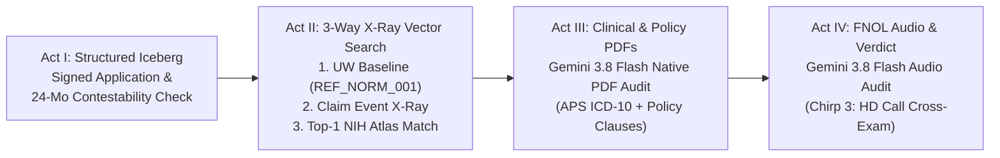

# Breaking the Unstructured Data Divide: Multi-Modal Life Insurance Claims Adjudication with BigLake Apache Iceberg, Object Tables, and Gemini 3.8 Flash

**By Guan Wang (`crownpku`)**

In enterprise **Life and Living Benefits Insurance** (Term Life, Whole Life, Critical Illness Riders, and Accidental Death & Dismemberment [AD&D] Double-Indemnity Riders), claims adjudication is rarely a simple lookup in a relational table. When a $1.5M Whole Life claim arrives seven months after policy issuance, or a beneficiary files a $2M AD&D double-indemnity claim following a mountain fall, the truth lives across **four completely different data modalities**:

1. **Structured Actuarial & Policy Core**: In-force status, Sum Assured, underwriting smoker/health class (*Preferred Plus Non-Smoker*), signed medical declarations, and whether the claim falls inside the **24-month Contestability Window**.
2. **Diagnostic Medical Radiographs**: Real emergency chest and trauma X-rays (`PNG`/`DICOM`) substantiating the cause of death or critical illness—or silently revealing an undisclosed pre-existing biventricular pacemaker or a recycled radiograph from a syndicated fraud ring.
3. **Legal Contracts & Clinical PDFs**: Multi-page Master Policy Wordings (Incontestability Clauses, Section 4.2 AD&D Mountaineering Exclusions, Section 2.1 Critical Illness severity definitions) and Attending Physician Statements (APS) with historical ICD-10 diagnosis dates.
4. **Beneficiary First Notice of Loss (FNOL) Audio**: Recorded contact center statements (`.wav`) where a spouse or beneficiary describes the incident timeline in their own words.

Historically, bridging these four modalities meant stitching together a fragile Rube Goldberg machine: a data warehouse for structured policies, bespoke Python OCR and Speech-to-Text microservices, an external vector database (like Pinecone or Milvus) for image embeddings, and public or presigned S3/GCS URLs shuttling Protected Health Information (PHI) across network boundaries.

Today, I am sharing how we built **OmniClaim Life Lakehouse** on Google Cloud—collapsing that entire stack into **a single governed BigQuery SQL namespace** using **BigLake Managed Apache Iceberg Tables**, **BigLake Object Tables (`ObjectRef`)**, **in-engine `VECTOR_SEARCH` (`gemini-embedding-2-preview`)**, and **Vertex AI Gemini 3.8 Flash**.

---

## 1. The Architecture: One SQL Engine Across Four Modalities

Instead of moving unstructured files out of Google Cloud Storage (GCS) into external vector stores or OCR pipelines, we keep every byte in a single private GCS bucket (`gs://your-gcp-project-id-bucket`) and expose both structured and unstructured assets directly to BigQuery via a **Cloud Resource Connection**:

```
                     Google Cloud Storage (Private Bucket)
  ┌───────────────────────────────────┬────────────────────────────────────┐
  │ iceberg_warehouse/                │ unstructured_evidence/             │
  │ • Parquet data + Iceberg metadata │ • ref_medical_atlas/*.png (NIH)    │
  │ • ACID snapshots & compaction     │ • claim_radiographs/*.png (NIH)    │
  │                                   │ • policy_and_aps_pdfs/*.pdf        │
  │                                   │ • beneficiary_fnol_audio/*.wav     │
  └─────────────────┬─────────────────┴──────────────────┬─────────────────┘
                    │                                    │
                    ▼                                    ▼
     BigLake Managed Apache Iceberg           BigLake Object Tables
     (`table_format = 'ICEBERG'`)          (`object_metadata = 'SIMPLE'`)
                    │                                    │
                    └─────────────────┬──────────────────┘
                                      ▼
                     BigQuery Lakehouse SQL Runtime
       ┌──────────────────────────────┼──────────────────────────────┐
       ▼                              ▼                              ▼
ML.GENERATE_EMBEDDING          VECTOR_SEARCH                  ML.GENERATE_TEXT
(gemini-embedding-2-preview  (Cosine Pathology &         (Gemini 3.8 Flash over
 3072-D Multimodal Vectors)   Fraud Ring Match)           PDF & Audio ObjectRefs)
```

---

## 2. Grounding in Real Open-Source Medical Data & A 4-Act Customer Storyline

Nothing ruins a healthcare or insurance AI demo faster than synthetic "stick-figure" drawings pretending to be radiographs or robotic 1990s offline TTS voices. To make **OmniClaim Life Lakehouse** clinically authentic and immediately reproducible, our data pipeline (`generate_data.py`) grounds every case in **real, peer-reviewed clinical radiographs and case findings** from the **US National Institutes of Health (NIH) National Library of Medicine Open-i / PubMed Central & MedPix repository**, paired with natural conversational voice recordings synthesized via **Google Cloud Text-to-Speech `Chirp 3: HD` (`en-US-Chirp3-HD-*`)**.

Even more importantly, an enterprise demo shouldn't feel like a random collection of files—it should tell a **longitudinal story** of a customer's journey from **Policy Issue Date** (when a healthy baseline chest X-ray `REF_NORM_001` from NIH `PMC12127709` was archived during underwriting) to **Claim Adjudication**:



### Spotlight Storyline: Catching a $1.5M Contestability Misrepresentation (`CLM-LIFE-1002` — Robert Sterling)

Consider how all four modalities converge to solve our flagship contestability investigation (`CLM-LIFE-1002`):

1. **Act I — The Paper Trail (`BigLake Apache Iceberg`)**:
   - Seven months ago, 62-year-old executive **Robert Sterling** applied for a **$1,500,000 Whole Life** policy (`POL-WL-PREF-2025`) at elite *Preferred Plus Non-Smoker* rates. On his signed underwriting questionnaire, he declared: *"No history of cardiac disease, arrhythmia, heart failure, or implanted medical devices."* Because his death occurred at **`months_since_issue = 7`** (< 24 months), the policy is **Contestable**.
2. **Act II — 3-Way Longitudinal Radiograph Forensics (`gemini-embedding-2-preview` + `VECTOR_SEARCH`)**:
   - When the emergency admission chest X-ray (`CLM-LIFE-1002_xray.png`, sourced from **NIH `PMC7033380` Panel A**, PMID: `32095464`) arrives, BigQuery compares its 3072-dimensional `gemini-embedding-2-preview` vector against our Reference Atlas.
   - Instead of matching a healthy chest (`REF_NORM_001`, NIH `PMC12127709`), it matches **`REF_CARDIOMEGALY_001`** (**NIH `PMC7033380` Panel B**—an earlier radiograph of the *exact same cardiac patient* taken prior to acute decompensation!) with **`0.9355` cosine similarity** (`radiograph_forensic_flag = 'CHRONIC_PRE_EXISTING_CARDIAC_INDICATOR'`). Both radiographs visibly reveal massive Stage III cardiomegaly (`cardiothoracic ratio > 0.65`) and a **biventricular Cardiac Resynchronization Therapy (CRT) pacemaker** with transvenous leads in the left subclavian vein.
3. **Act III — Clinical APS & Policy PDF Cross-Examination (`Gemini 3.8 Flash` + `ObjectRef`)**:
   - Passing the Attending Physician Statement PDF and Whole Life Policy PDF directly into `ML.GENERATE_TEXT` via `ObjectRef`, Gemini 3.8 Flash extracts **ICD-10 I42.0 (Chronic Dilated Cardiomyopathy) and Z95.0 (Presence of Cardiac Pacemaker)** first diagnosed **4 years prior to policy application**, violating **Section 1.2 (24-Month Contestability Clause)**.
4. **Act IV — Recorded FNOL Audio Cross-Examination (`Chirp 3: HD` `.wav` + `ObjectRef`)**:
   - Listening natively to the spouse's recorded FNOL phone call (`CLM-LIFE-1002_fnol.wav`), Gemini 3.8 Flash captures the decisive admission: *"We rushed him to the emergency room and called his regular cardiologist, Doctor Grant, who has been treating his enlarged heart and checking his pacemaker for the past four years."*
   - **Final Unified Verdict**: **`SIU_RESCISSION_HOLD` ($0 Approved Payout)**.

### All 5 Hero Life Insurance Cases & Live BigQuery Metrics

| Claim ID | Insured & Scenario | NIH Open-i / PMC Radiograph Source | Live `VECTOR_SEARCH` Match & Cosine Similarity | Live `gemini-3.8-flash` Verdict & Approved Payout |
| :--- | :--- | :--- | :--- | :--- |
| **`CLM-LIFE-1001`** | **Eleanor Vance**<br>$500K Term Life (68m Incontestable) | **NIH `PMC10405870`** (PMID: `37554481`)<br>Dense RLL lobar pneumonia consolidation | **`REF_PNEUMONIA_001`**<br>(`CONSISTENT_ACUTE_OR_TRAUMA_FINDING`) | ✅ **`AUTO_APPROVE_PAYOUT`**<br>**$500,000** |
| **`CLM-LIFE-1002`** | **Robert Sterling**<br>$1.5M Whole Life (7m Contestable) | **NIH `PMC7033380`** (PMID: `32095464`)<br>Panel A vs. Panel B: Cardiomegaly + CRT pacemaker | **`REF_CARDIOMEGALY_001`**<br>**`0.9355` similarity** (`CHRONIC_PRE_EXISTING_CARDIAC_INDICATOR`) | 🚨 **`SIU_RESCISSION_HOLD`**<br>**$0** |
| **`CLM-ADD-1003`** | **Marcus Thorne**<br>$1M Base + $1M AD&D (38m) | **NIH `PMC5702695`** (PMID: `29181345`)<br>Displaced mid-shaft clavicle fracture | **`REF_TRAUMA_001`**<br>**`0.9547` similarity** (`CONSISTENT_ACUTE_OR_TRAUMA_FINDING`) | ⚠️ **`PARTIAL_APPROVE_BASE_DENY_ADD_RIDER`**<br>**$1,000,000** *(Base Only)* |
| **`CLM-CI-1004`** | **Victor Krum**<br>$350K CI Rider (14m Fraud Ring) | **NIH `MedPix MPX1219`** (`synpic14404`)<br>Recycled LUL lung mass X-ray (perturbed hash) | **`PRIOR_CLM_8821_FRAUD`**<br>**`0.9962` similarity** (`CRITICAL_DUPLICATE_IMAGE_FRAUD`) | 🛑 **`SIU_FRAUD_RING_REJECT`**<br>**$0** |
| **`CLM-CI-1005`** | **Diana Chen**<br>$250K CI Rider (29m Living Benefit) | **NIH `PMC7529567`** (PMID: `32869499`)<br>30x20mm RUL primary lung adenocarcinoma | **`REF_PULM_MASS_001`**<br>**`0.9668` similarity** (`CONSISTENT_ACUTE_OR_TRAUMA_FINDING`) | ✅ **`APPROVE_LIVING_BENEFIT`**<br>**$250,000** |

---

## 3. Building the Lakehouse in SQL: Step-by-Step

### Step 1: BigLake Managed Apache Iceberg & Object Tables (`sql/01_lakehouse_ddl.sql`)

To create a real **Managed Apache Iceberg** table in BigQuery backed by Parquet files and Iceberg metadata manifests in our own GCS bucket, we bind the table to our Cloud Resource Connection:

```sql
CREATE TABLE IF NOT EXISTS `your-gcp-project-id.omniclaim_lakehouse.iceberg_claims_policies` (
    claim_id STRING NOT NULL,
    policy_id STRING NOT NULL,
    policyholder_id STRING NOT NULL,
    policy_code STRING NOT NULL,
    product_type STRING,
    insured_name STRING,
    dob DATE,
    gender STRING,
    uw_health_class STRING,
    declared_smoker BOOL,
    declared_medical_history STRING,
    issue_date DATE,
    event_date DATE,
    months_since_issue INT64,
    is_within_contestability BOOL,
    claim_type STRING,
    base_sum_assured FLOAT64,
    has_add_rider BOOL,
    add_rider_sum_assured FLOAT64,
    has_ci_rider BOOL,
    ci_rider_sum_assured FLOAT64,
    claimed_benefit_amount FLOAT64,
    beneficiary_name STRING,
    beneficiary_relationship STRING,
    reported_cause_of_event STRING,
    image_gcs_uri STRING,
    aps_pdf_gcs_uri STRING,
    policy_pdf_gcs_uri STRING,
    fnol_audio_gcs_uri STRING,
    expected_action STRING,
    expected_payout FLOAT64
)
CLUSTER BY claim_id, policy_id
WITH CONNECTION `your-gcp-project-id.us-central1.lakehouse-omniclaim-conn`
OPTIONS (
    file_format = 'PARQUET',
    table_format = 'ICEBERG',
    storage_uri = 'gs://your-gcp-project-id-bucket/iceberg_warehouse/iceberg_claims_policies'
);
```

Next, we expose our unstructured NIH radiographs, PDFs, and `Chirp 3: HD` `.wav` audio files on GCS as **BigLake Object Tables** using `object_metadata = 'SIMPLE'` and register our Vertex AI models (`gemini-embedding-2-preview` and `gemini-3.8-flash`):

```sql
CREATE OR REPLACE EXTERNAL TABLE `your-gcp-project-id.omniclaim_lakehouse.obj_claim_radiographs`
WITH CONNECTION `your-gcp-project-id.us-central1.lakehouse-omniclaim-conn`
OPTIONS (
    object_metadata = 'SIMPLE',
    uris = ['gs://your-gcp-project-id-bucket/unstructured_evidence/claim_radiographs/*.png']
);

CREATE OR REPLACE MODEL `your-gcp-project-id.omniclaim_lakehouse.model_multimodal_embedding`
REMOTE WITH CONNECTION `your-gcp-project-id.us-central1.lakehouse-omniclaim-conn`
OPTIONS (endpoint = 'gemini-embedding-2-preview');

CREATE OR REPLACE MODEL `your-gcp-project-id.omniclaim_lakehouse.model_gemini_auditor`
REMOTE WITH CONNECTION `your-gcp-project-id.us-central1.lakehouse-omniclaim-conn`
OPTIONS (endpoint = 'gemini-3.8-flash');
```

---

### Step 2: Radiograph Embeddings & In-Engine `VECTOR_SEARCH`

With the Object Tables in place, we generate 3072-dimensional vector embeddings directly over the GCS radiographs using `ML.GENERATE_EMBEDDING` and run `VECTOR_SEARCH` comparing submitted claim radiographs (`claims_image_embeddings`) against our Reference Medical & Prior-Claims Atlas (`ref_medical_atlas_embeddings`):

```sql
CREATE OR REPLACE TABLE `your-gcp-project-id.omniclaim_lakehouse.stg_radiograph_vector_forensics` AS
WITH VectorMatches AS (
    SELECT
        query.claim_id,
        query.image_gcs_uri AS submitted_image_uri,
        base.ref_image_id AS matched_ref_image_id,
        base.image_gcs_uri AS matched_ref_image_uri,
        distance AS cosine_distance,
        ROUND(1.0 - distance, 4) AS cosine_similarity
    FROM VECTOR_SEARCH(
        TABLE `your-gcp-project-id.omniclaim_lakehouse.ref_medical_atlas_embeddings`,
        'embedding',
        TABLE `your-gcp-project-id.omniclaim_lakehouse.claims_image_embeddings`,
        'embedding',
        top_k => 1,
        distance_type => 'COSINE',
        options => '{"use_brute_force": true}'
    )
)
SELECT
    vm.*,
    meta.pathology_label AS detected_radiograph_pathology,
    meta.prior_claim_id,
    CASE
        WHEN meta.reference_category = 'HISTORICAL_PRIOR_CLAIM' AND vm.cosine_distance < 0.05
            THEN 'CRITICAL_DUPLICATE_IMAGE_FRAUD'
        WHEN meta.pathology_label LIKE '%CARDIOMEGALY%'
            THEN 'CHRONIC_PRE_EXISTING_CARDIAC_INDICATOR'
        ELSE 'CONSISTENT_ACUTE_OR_TRAUMA_FINDING'
    END AS radiograph_forensic_flag
FROM VectorMatches vm
JOIN `your-gcp-project-id.omniclaim_lakehouse.dim_ref_medical_atlas_meta` meta
    ON vm.matched_ref_image_id = meta.ref_image_id;
```

---

### Step 3: Native PDF & Audio Cross-Examination with `ObjectRef`

Here is where the Google Cloud Lakehouse shines. Rather than building an external OCR pipeline for PDFs or a Speech-to-Text pipeline for `.wav` audio, we construct **`ObjectRef`** pointers (`OBJ.FETCH_METADATA(OBJ.MAKE_REF(uri, connection))`) and pass them in a `STRUCT(prompt, object_ref_list)` directly to **Gemini 3.8 Flash** inside `ML.GENERATE_TEXT`:

```sql
CREATE OR REPLACE TABLE `your-gcp-project-id.omniclaim_lakehouse.stg_document_clinical_audit` AS
SELECT
    claim_id,
    ml_generate_text_llm_result AS pdf_clinical_contract_audit
FROM ML.GENERATE_TEXT(
    MODEL `your-gcp-project-id.omniclaim_lakehouse.model_gemini_auditor`,
    (
        SELECT
            c.claim_id,
            STRUCT(
                CONCAT(
                    'Review the attached Policy Wording PDF and Attending Physician Statement (APS) PDF for Claim ', c.claim_id, '...\n'
                ) AS prompt,
                [
                    OBJ.FETCH_METADATA(OBJ.MAKE_REF(c.policy_pdf_gcs_uri, 'your-gcp-project-id.us-central1.lakehouse-omniclaim-conn')),
                    OBJ.FETCH_METADATA(OBJ.MAKE_REF(c.aps_pdf_gcs_uri, 'your-gcp-project-id.us-central1.lakehouse-omniclaim-conn'))
                ] AS object_ref_list
            ) AS prompt
        FROM `your-gcp-project-id.omniclaim_lakehouse.iceberg_claims_policies` c
        JOIN `your-gcp-project-id.omniclaim_lakehouse.stg_radiograph_vector_forensics` vf
          ON c.claim_id = vf.claim_id
    ),
    STRUCT(0.0 AS temperature, 1024 AS max_output_tokens, TRUE AS flatten_json_output)
);
```

We then pass the beneficiary's `.wav` recording (`fnol_audio_gcs_uri`) via `OBJ.FETCH_METADATA(OBJ.MAKE_REF(...))` into Step 3B so Gemini 3.8 Flash listens to the caller's voice recording, cross-checks it against the Iceberg policy data, X-ray vector forensics, and PDF audit, and emits a structured JSON verdict!

---

## 4. Five Engineering "Gotchas" We Solved Along the Way

Building and verifying a real multi-modal lakehouse on Google Cloud surfaced five practical engineering lessons worth sharing:

1. **BigQuery Managed Iceberg DDL Rules (`CREATE TABLE` vs. `CREATE OR REPLACE`)**:
   - Standard BigQuery tables support `CREATE OR REPLACE TABLE` and `PARTITION BY`. BigQuery **Managed Apache Iceberg** tables (`table_format = 'ICEBERG'`, `file_format = 'PARQUET'`) require `CREATE TABLE IF NOT EXISTS`, use `CLUSTER BY` for physical layout optimization, and require the Cloud Resource Connection service account to hold `roles/storage.objectAdmin` (not just `objectViewer`) so BigQuery can write Parquet data files and Iceberg metadata manifests to your bucket.
2. **Avoiding the "Self-Join Distance 0.0" Trap in `VECTOR_SEARCH`**:
   - A common mistake in tutorials is running `VECTOR_SEARCH` on `claims_image_embeddings` against itself with `top_k => 1`—which trivially matches every claim radiograph to itself at `distance = 0.0`! By separating our **Reference Pathology & Historical Prior-Claims Atlas** (`ref_medical_atlas_embeddings`) from **Submitted Claim Radiographs** (`claims_image_embeddings`), `top_k => 1` performs genuine clinical classification and cross-policy fraud detection.
3. **Why Exact Brute-Force Beats IVF Indexing on Small Datasets**:
   - In BigQuery, `CREATE VECTOR INDEX ... OPTIONS(index_type='IVF')` requires at least **5,000 rows**. For a fast, educational POC or daily batch triage queue, passing `options => '{"use_brute_force": true}'` to `VECTOR_SEARCH` computes exact cosine distance in milliseconds with zero index build latency.
4. **Parsing `OBJ.GET_ACCESS_URL` JSON Envelopes for Zero-Egress Media Rendering**:
   - Enterprise insurance buckets enforce `--public-access-prevention`, meaning raw `https://storage.googleapis.com/...` links fail with `403 Forbidden`. Calling `OBJ.GET_ACCESS_URL(OBJ.MAKE_REF(uri, connection), 'r')` directly inside our `vw_claim_adjudication_360` SQL view generates time-limited signed read URLs on the fly, returning a JSON envelope `{"access_urls": {"read_url": "https://storage.googleapis.com/..."}}` that our Streamlit UI unpacks to render private X-rays, PDFs, and `.wav` audio securely.
5. **Real Clinical Data + Longitudinal Storytelling Beat Toy Synthetics**:
   - Using real peer-reviewed chest and trauma radiographs from **NIH Open-i / PubMed Central** (like pairing Panel B and Panel A of `PMC7033380` to show the same cardiac patient's pacemaker across time) and **Google Cloud `Chirp 3: HD`** conversational voices turned abstract SQL queries into an immediately believable Special Investigations Unit (SIU) narrative.

---

## 5. Try It Yourself

The complete open-source repository—including the NIH Open-i & `Chirp 3: HD` multi-modal data generator (`generate_data.py`), GCP provisioning script (`setup_gcp.sh`), BigQuery Lakehouse orchestrator (`run_lakehouse.py`), and 4-Act Storyline Streamlit Workbench (`app.py`)—is available to run in four commands:

```bash
uv sync
uv run python generate_data.py
bash setup_gcp.sh
uv run python run_lakehouse.py
uv run streamlit run app.py
```
