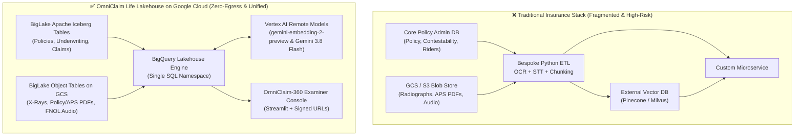
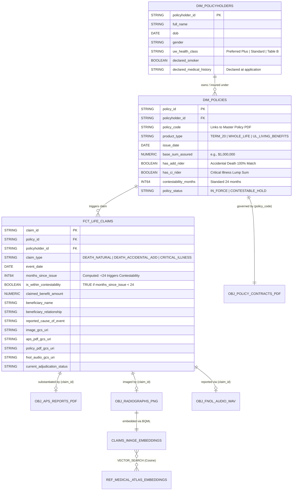

# OmniClaim Life Lakehouse: Spec-Driven Development (SDD) Specification & Implementation Plan
### Multi-Modal Life & Living Benefits Claims Adjudication with BigLake Iceberg, BigLake Object Tables, and Vertex AI in BigQuery

---

## 1. Executive Summary & Architectural Critique of Original Draft

### 1.1 Purpose of This Document
This document serves as both the **Product & Architecture Specification** and the **Spec-Driven Development (SDD) Implementation Plan** for **OmniClaim Life Lakehouse**—an educational Proof-of-Concept (POC) showcasing Google Cloud’s multi-modal lakehouse capabilities deeply grounded in **Life & Living Benefits Insurance** (Term/Whole Life, Critical Illness Riders, Accidental Death & Dismemberment [AD&D] Riders, and 2-Year Contestability Investigations).

### 1.2 Critical Review & Challenges to the Original Specification
To make this project **technically accurate, feasible to build in hours (not weeks), low-cost, educational, and authentic to Life Insurance**, we challenged and corrected six major gaps in the initial draft:

| # | Original Draft Flaw / Ambiguity | Challenge & Root Cause | Spec-Driven Fix in This Blueprint |
| :--- | :--- | :--- | :--- |
| **1** | **Domain Drift (P&C / Health vs. Life Insurance)** | Original spec used P&C/Health concepts (`deductible_applied`, motor claims, fracture trauma X-rays, CMS Medicare PDFs). Standard Life & AD&D insurance does not use deductibles; it revolves around **Sum Assured (Face Amount)**, **Contestability Windows (24-month rule)**, **Material Misrepresentation** (undisclosed pre-existing conditions vs. underwriting class), **Beneficiary Designations**, and **Mortality/Morbidity Exclusions** (Suicide, Aviation/Hazardous Sports, Intoxication). | Re-architected the entire schema, prompts, and 5 "Hero Claim Scenarios" around authentic **Life, Critical Illness (CI), and AD&D Rider Adjudication & SIU (Special Investigations Unit) Contestability Auditing**. |
| **2** | **Invalid Apache Iceberg DDL in BigQuery** | Phase 2 used standard BigQuery `CREATE OR REPLACE TABLE` without `WITH CONNECTION` or `OPTIONS(table_format='ICEBERG')`, and only granted `roles/storage.objectViewer`. Furthermore, BigQuery Managed Iceberg tables do not support `CREATE OR REPLACE` or `PARTITION BY`. | Updated DDL to authentic BigQuery Managed Iceberg syntax (`CREATE TABLE ... CLUSTER BY ... WITH CONNECTION ... OPTIONS(file_format='PARQUET', table_format='ICEBERG', storage_uri='gs://...')`) and upgraded connection IAM to `roles/storage.objectAdmin`. |
| **3** | **Fake Audio Audit (Joined a Text Table Instead of Multimodal Object Table)** | Phase 4 (`CallTranscriptionAudit`) queried a non-existent `dim_fnol_transcripts.transcript_text` column instead of passing the actual audio & PDF objects from BigLake Object Tables to Gemini. | Uses BigQuery's native **`ObjectRef`** (`ref` column in BigLake Object Tables and `OBJ.MAKE_REF`) passed directly as `STRUCT` inputs into `ML.GENERATE_TEXT` / `AI.GENERATE_TEXT`, allowing **Gemini 3.8 Flash** to natively listen to `.wav` beneficiary statements and read `.pdf` policy contracts & Attending Physician Statements (APS) inside SQL. |
| **4** | **Self-Join Vector Search Bug & 5,000-Row IVF Index Trap** | Searching `claims_image_embeddings` against itself with `top_k => 1` always matches the target claim to itself (`distance = 0.0`). Additionally, `CREATE VECTOR INDEX ... OPTIONS(index_type='IVF')` requires **>= 5,000 rows** in BigQuery or index creation fails/no-ops. | Separated **Submitted Claim Radiographs** (`claims_image_embeddings`) from the **Reference Pathology & Historical Claims Atlas** (`ref_medical_atlas_embeddings`). Default POC mode uses exact `VECTOR_SEARCH(..., options => '{"use_brute_force": true}')` for instant zero-wait execution, plus an optional flag to synthesize 5,000 padded vectors to demonstrate IVF indexing. |
| **5** | **Heavy External Dataset Dependencies (40GB+ NIH / Synthea)** | Requiring developers to download 40GB of NIH Chest X-rays, run Java-based Synthea, and scrape Medicare PDFs creates massive friction for an educational POC. | Designed a **Self-Contained `uv` Python Data Generator** (`pipelines/generate_poc_data.py`) that deterministically synthesizes the structured records, generates real multi-page Life Policy + APS PDFs (`fpdf2`), curates/synthesizes 10 cardiopulmonary & trauma radiographs (`Pillow`), and synthesizes beneficiary call `.wav` files (Cloud TTS with offline fallback) in **under 60 seconds**. |
| **6** | **Broken Private GCS URLs in Streamlit UI** | Replacing `gs://` with `https://storage.googleapis.com/` in `app.py` results in `403 Forbidden` unless the GCS bucket is public (an enterprise security anti-pattern). | Uses BigQuery’s native **`OBJ.GET_ACCESS_URL(ref, 'r')`** function inside the adjudication SQL view to generate secure, time-limited signed URLs for images, PDFs, and audio with **zero public bucket exposure**. |

---

## 2. Project Overview & Sprint Submission Metadata

| Field | Detail |
| :--- | :--- |
| **Project Title** | **OmniClaim Life Lakehouse**: Multi-Modal Life & Living Benefits Claims Adjudication Indexing Cardiopulmonary Radiographs, Policy & APS PDFs, and Beneficiary Call Audio with BigLake Object Tables and Apache Iceberg |
| **Sprint Track** | Agents and AI (*"Building Multi-Modal Lakehouses: Indexing Images, PDFs, and Audio with Lakehouse Object Tables"*) |
| **Target Audience** | Enterprise Data Architects, Life Insurance Actuaries & Claims Transformation Leaders, AI/ML Engineers |
| **Google Cloud Stack** | BigLake Managed Apache Iceberg Tables, BigLake Object Tables (`ObjectRef`), BigQuery (BQML, `VECTOR_SEARCH`, `ML.GENERATE_EMBEDDING`, `ML.GENERATE_TEXT` / `AI.GENERATE_TEXT`, `OBJ.GET_ACCESS_URL`), Google Cloud Storage (GCS), Vertex AI (`gemini-embedding-2-preview`, `gemini-3.8-flash`), Cloud Text-to-Speech |
| **Python & Tooling** | Python 3.11+ managed strictly via **`uv`**, `google-cloud-bigquery`, `google-cloud-storage`, `google-cloud-texttospeech`, `fpdf2`, `pillow`, `streamlit` |
| **Output Formats** | Technical Architecture Blog (Medium / Dev.to), Open-Source Reproducible GitHub Repo, Video Walkthrough |
| **Author** | Guan Wang (GDE AI & Cloud, Singapore / APAC) |

###Updated Spreadsheet Entry ("Project List" Tab)

| Column Name | Input Value |
| :--- | :--- |
| **Project Title** | OmniClaim Life Lakehouse: Multi-Modal Life & Living Benefits Claims Adjudication with BigLake Object Tables and Apache Iceberg |
| **Project Description** | **[Problem]** In Life and Living Benefits insurance (Term/Whole Life, Critical Illness, and Accidental Death & Dismemberment [AD&D]), claims adjudication—especially during the 2-year contestability period—is bottlenecked by the "unstructured data divide." Structured policy records, underwriting risk classes, and beneficiary designations reside in core tables, while critical adjudicating evidence—Attending Physician Statements (APS), chest/trauma radiographs, policy & rider endorsement PDFs, and recorded beneficiary First Notice of Loss (FNOL) audio statements—is marooned in object storage or synced into external vector databases. This fragmentation breaks transactional governance, risks PHI/PII exposure, and prevents Special Investigations Units (SIU) and claims examiners from running cross-modal contestability and exclusion audits in a single query.<br><br>**[Solution & Architecture]** Built OmniClaim Life Lakehouse on Google Cloud to unify structured actuarial/policy records and unstructured clinical/legal/voice evidence in a single governed BigQuery namespace. Using **BigLake Managed Apache Iceberg** tables for structured policy & claim state and **BigLake Object Tables** (`ObjectRef`) over Google Cloud Storage for raw media, the platform performs in-engine multimodal vector indexing and generative cross-examination without external vector databases or ETL pipelines.<br><br>**[Life Insurance Multi-Modal Adjudication Workflow]** Demonstrates an end-to-end life & rider claim adjudication pipeline across four synchronized modalities:<br>1. *Structured Policy & Contestability Core (Apache Iceberg)*: Evaluates policy in-force status, Sum Assured ($500K–$2M), underwriting smoker/health class, and automatically flags claims occurring within the **24-month Contestability Window**.<br>2. *Medical Radiograph Forensics (`gemini-embedding-2-preview` + `VECTOR_SEARCH`)*: Generates dense embeddings directly over BigLake Object Tables containing submitted chest and trauma radiographs, matching them against a reference medical & historical claims atlas to detect **undisclosed pre-existing pathology** (e.g., chronic cardiomegaly vs. Preferred Plus underwriting) and **recycled radiograph fraud** across policies.<br>3. *Policy Contract & APS PDF Auditing (`gemini-3.8-flash` via `ObjectRef`)*: Passes PDF object references directly to Gemini in SQL to cross-examine Policy Rider Endorsements (Suicide Clause, Aviation/Mountaineering Exclusions, Critical Illness definitions) against Attending Physician Statements.<br>4. *Beneficiary FNOL Audio Cross-Examination (`gemini-3.8-flash` via `ObjectRef`)*: Analyzes recorded beneficiary/claimant `.wav` statements natively from GCS to detect timeline discrepancies, intoxication/hazardous activity admissions, and distress/coercion markers.<br><br>**[Outcome]** Eliminates external vector database silos and bespoke OCR/STT microservices, enabling single-query, zero-egress multi-modal life claims triage with secure signed-URL visualization (`OBJ.GET_ACCESS_URL`). |

---

## 3. Life Insurance Domain Context & Problem Statement

### 3.1 Why Life Insurance Adjudication is Uniquely Multi-Modal
Unlike high-frequency, low-severity P&C or dental claims, **Life Insurance, Critical Illness (CI), and Accidental Death & Dismemberment (AD&D)** claims are **low-frequency, high-severity ($250,000 to $5,000,000+ Sum Assured)** events where every complex claim requires cross-referencing four distinct modalities of evidence:

1. **The 2-Year Contestability Period & Material Misrepresentation**:
   * Under standard life insurance law, if a death or critical illness claim occurs within **24 months** of the policy `issue_date` (or reinstatement), the policy is *contestable*.
   * The insurer's **Special Investigations Unit (SIU)** and medical underwriters must audit whether the insured committed **material misrepresentation** on their initial application—for example, applying as *"Preferred Plus Non-Smoker with no cardiac/pulmonary history"* while an Attending Physician Statement (APS) and hospital Chest X-Ray reveal chronic Stage III Cardiomegaly or a pre-existing pulmonary mass predating policy issuance.
2. **AD&D Rider Double-Indemnity & Exclusion Clauses**:
   * When an insured dies in an accident, beneficiaries often claim both the **Base Life Sum Assured** and a **100% AD&D Rider match** (Double Indemnity).
   * Adjudicators must verify that the proximate cause of death was an *independent external accidental bodily injury* (substantiated by trauma radiographs and coroner reports) and was **not excluded** by specific rider provisions in the policy PDF (e.g., **Hazardous Sports / Unroped Mountaineering Exclusion**, **Private Non-Commercial Aviation Exclusion**, **Voluntary Intoxication / Narcotics Exclusion**, or the **24-Month Suicide Clause**).
3. **Living Benefits / Critical Illness (CI) Rider Clinical Thresholds**:
   * Living benefit riders pay out a lump sum upon diagnosis of specified conditions (e.g., *End-Stage Renal Failure, Severe Cardiomyopathy, Invasive Cancer, Major Organ Transplant*).
   * Examiners must verify that clinical imaging and physician reports strictly meet the contract’s physiological severity definitions and survived the **90-day CI Waiting Period**.
4. **Syndicated Claim Fraud & Medical Document Recycling**:
   * Organized fraud rings submit identical or lightly cropped diagnostic radiographs and forged Attending Physician Statements across multiple carriers or multiple policies to trigger Living Benefit / AD&D payouts.

### 3.2 Architectural Comparison: Siloed Stack vs. OmniClaim Life Lakehouse



---

## 4. Functional & Non-Functional Requirements (SDD Spec)

### 4.1 Functional Requirements (FR)
* **FR-01 (Synthetic Life Insurance Data Synthesis)**: Provide a single, deterministic Python CLI tool (`pipelines/generate_poc_data.py` run via `uv`) that generates structured CSV/Parquet seeds, multi-page Policy Wording & Attending Physician Statement (APS) PDFs, medical radiograph PNGs, and Beneficiary FNOL `.wav` audio files for **5 Hero Claim Scenarios** plus background policies/reference images.
* **FR-02 (Open Table Format Core via Apache Iceberg)**: Store core structured life insurance entities (`dim_policyholders`, `dim_policies`, `fct_life_claims`) as **BigQuery Managed Apache Iceberg tables** (`table_format = 'ICEBERG'`, `file_format = 'PARQUET'`) backed by Google Cloud Storage and a Cloud Resource Connection.
* **FR-03 (Zero-Copy Unstructured Cataloging via BigLake Object Tables)**: Expose three GCS prefixes (`radiographs/`, `clinical_and_policy_pdfs/`, `beneficiary_fnol_audio/`) as **BigLake Object Tables** (`object_metadata = 'SIMPLE'`), exposing `uri`, `ref` (`ObjectRef`), `content_type`, `size`, and `updated` directly to SQL.
* **FR-04 (In-Engine Medical Image Embedding & Vector Forensics)**: Use a BQML Remote Model (`gemini-embedding-2-preview`) and `ML.GENERATE_EMBEDDING` over the radiograph Object Table to populate both a **Reference Medical & Prior-Claims Atlas** (`ref_medical_atlas_embeddings`) and **Submitted Claim Embeddings** (`claims_image_embeddings`). Execute `VECTOR_SEARCH` to compute cosine distance against known pathology patterns and prior claims (flagging image reuse fraud when `distance < 0.05` to a prior claim, or pathology mismatch against underwriting class).
* **FR-05 (Native Multimodal PDF & Audio Cross-Examination via `ObjectRef`)**: Use a BQML Remote Model (`gemini-3.8-flash`) with `ML.GENERATE_TEXT` (passing `ObjectRef` structs from the PDF and Audio Object Tables) to perform automated **Contestability & Exclusion Auditing**—comparing Structured Underwriting Declarations + Policy Contract PDF + APS PDF + Beneficiary Recorded Audio in a single workflow.
* **FR-06 (Unified Multi-Modal Adjudication View)**: Provide a production-grade SQL view/table (`omniclaim_lakehouse.mart_claim_adjudication_360`) that joins Iceberg policy/contestability metrics, Vector Search radiograph forensics, Gemini multimodal audit JSON/verdicts, and secure signed URLs (`OBJ.GET_ACCESS_URL(ref, 'r')`).
* **FR-07 (Examiner & SIU Interactive Workbench)**: Provide a Streamlit web application (`webapp/app.py`) where a Life Claims Examiner or SIU Investigator can select any of the 5 Hero Claims, inspect structured policy & contestability status, view the submitted X-ray alongside the closest matched reference/prior X-ray, listen to the beneficiary FNOL audio player, inspect the Policy/APS PDF, and review Gemini's structured adjudication recommendation.

### 4.2 Non-Functional Requirements (NFR)
* **NFR-01 (Feasibility & Speed)**: Full end-to-end setup (data generation + GCS upload + BigQuery DDL + embeddings + Gemini audit) must complete in **< 10 minutes** and cost **< $2.00 in GCP consumption**.
* **NFR-02 (Zero Public Storage Exposure)**: GCS bucket must enforce `--uniform-bucket-level-access` and `--public-access-prevention`. Media rendering in the UI must exclusively use BigQuery `OBJ.GET_ACCESS_URL` signed URLs.
* **NFR-03 (Strict `uv` Python Environment)**: All local/pipeline Python dependencies must be managed in a reproducible `pyproject.toml` and executed via `uv run`.
* **NFR-04 (Idempotency)**: All setup scripts, data generators, and SQL DDLs must be re-runnable without manual cleanup failures.

---

## 5. Data Model & The 5 "Hero" Life Insurance Scenarios

### 5.1 Unified Multi-Modal Entity Schema



### 5.2 The 5 Curated "Hero" Life Insurance Claim Scenarios
To make the POC immediately educational and impactful in demos and articles, the synthetic generator creates **5 vivid, realistic life insurance cases** (plus 50 background claims and a reference medical image atlas):

| Claim ID | Policy & Rider Type | Claimed Benefit | Contestability (`months_since_issue`) | Multi-Modal Evidence Alignment | Expected OmniClaim Lakehouse Verdict |
| :--- | :--- | :--- | :--- | :--- | :--- |
| **`CLM-LIFE-1001`**<br>*(Clean Fast-Track)* | 20-Yr Term Life (`POL-TERM-STD-2025`) | **$500,000**<br>*(Natural Death)* | **68 months**<br>*(Incontestable)* | • **Iceberg**: Preferred Non-Smoker, policy active > 5 yrs.<br>• **X-Ray Vector**: Matches acute bacterial pneumonia (`dist = 0.09`).<br>• **APS PDF & FNOL Audio**: Consistent acute pneumonia timeline; no exclusions apply. | ✅ **`AUTO_APPROVE_PAYOUT`**<br>*(Incontestable period passed; clinical & audio evidence consistent)* |
| **`CLM-LIFE-1002`**<br>*(Contestable Material Misrepresentation)* | Whole Life (`POL-WL-PREF-2025`) | **$1,500,000**<br>*(Cardiac Death)* | **7 months**<br>⚠️ *(Contestable < 24m)* | • **Iceberg**: Applied as *Preferred Plus Non-Smoker*, declared *"Zero cardiac/pulmonary history"*.<br>• **X-Ray Vector**: Strong match (`dist = 0.06`) to **Chronic Severe Cardiomegaly & Pacemaker Lead**.<br>• **APS PDF**: Physician notes 5-year history of dilated cardiomyopathy.<br>• **FNOL Audio**: Spouse inadvertently mentions *"his heart specialist of 4 years"*. | 🚨 **`SIU_RESCISSION_HOLD`**<br>*(Material Misrepresentation within 24-month Contestability Window)* |
| **`CLM-ADD-1003`**<br>*(AD&D Rider Hazardous Sport Exclusion)* | Term Life + AD&D Double Indemnity (`POL-ADD-EXEC-2025`) | **$2,000,000**<br>*($1M Base + $1M AD&D)* | **38 months**<br>*(Incontestable for Base Life; AD&D Rider Exclusions apply)* | • **Iceberg**: Claiming $1M Base + $1M AD&D Rider for *"accidental fall on hiking trail"*.<br>• **X-Ray Vector**: Matches high-velocity cervical/thoracic trauma.<br>• **Policy PDF**: Section 4.2 excludes AD&D payout for *free-solo / unroped technical mountaineering above 4,000m* or *BAC > 0.08%*.\n• **FNOL Audio & APS PDF**: Beneficiary audio admits insured was *free-solo ice climbing on Mt. Rainier*. | ⚠️ **`PARTIAL_APPROVE_BASE_DENY_ADD_RIDER`**<br>*(Pay $1M Base Life; Deny $1M AD&D Rider under Section 4.2 Mountaineering Exclusion)* |
| **`CLM-CI-1004`**<br>*(Syndicated Radiograph Fraud Ring)* | Universal Life + Critical Illness Rider (`POL-UL-CI-2025`) | **$350,000**<br>*(Critical Illness Lump Sum)* | **14 months**<br>⚠️ *(Contestable < 24m)* | • **Iceberg**: Accelerated Living Benefit claim for acute pulmonary mass.<br>• **X-Ray Vector**: **Exact / Near-Duplicate Match (`dist = 0.008`)** to a radiograph previously submitted 9 months ago under a *different policyholder* (`PRIOR-CLM-8821`).<br>• **APS PDF & Audio**: Clinic license number unverified; vague beneficiary answers on call. | 🛑 **`SIU_FRAUD_RING_REJECT`**<br>*(Biometric/Radiograph duplicate reuse detected via BigQuery Vector Search)* |
| **`CLM-CI-1005`**<br>*(Valid Critical Illness Living Benefit)* | Universal Life + Critical Illness Rider (`POL-UL-CI-2025`) | **$250,000**<br>*(Critical Illness Lump Sum)* | **29 months**<br>*(Past 90-day waiting & 24m contestability)* | • **Iceberg**: Active CI rider, 29 months in force.<br>• **X-Ray Vector**: Matches verified acute pulmonary pathology (`dist = 0.08`) with zero prior-claim duplication.<br>• **Policy/APS PDF & Audio**: Meets Section 2.1 clinical severity threshold; timeline consistent across claimant audio and oncologist APS. | ✅ **`APPROVE_LIVING_BENEFIT`**<br>*(Qualifies for accelerated CI lump-sum payout)* |

---

## 6. End-to-End Technical Architecture & SQL Specification

### 6.1 Google Cloud Storage & BigQuery Namespace Layout

```text
gs://${BUCKET_NAME}/
├── iceberg_warehouse/                        # Managed by BigQuery Apache Iceberg Engine
│   ├── dim_policyholders/                    # Parquet data + Iceberg metadata/manifests
│   ├── dim_policies/
│   └── fct_life_claims/
└── unstructured_evidence/                    # Mapped via BigLake Object Tables
    ├── ref_medical_atlas/                    # Reference pathology & prior-claim radiographs (PNG)
    │   ├── REF_NORM_001.png
    │   ├── REF_CARDIOMEGALY_001.png
    │   ├── REF_PNEUMONIA_001.png
    │   ├── REF_TRAUMA_001.png
    │   ├── REF_PULM_MASS_001.png
    │   └── PRIOR_CLM_8821_FRAUD.png          # Historical claim image used to catch CLM-CI-1004
    ├── claim_radiographs/                    # Submitted claim radiographs (PNG)
    │   ├── CLM-LIFE-1001_xray.png
    │   ├── CLM-LIFE-1002_xray.png
    │   ├── CLM-ADD-1003_xray.png
    │   ├── CLM-CI-1004_xray.png
    │   └── CLM-CI-1005_xray.png
    ├── policy_and_aps_pdfs/                  # Master Policy Contracts & Attending Physician Statements (PDF)
    │   ├── POL-TERM-STD-2025.pdf
    │   ├── POL-WL-PREF-2025.pdf
    │   ├── POL-ADD-EXEC-2025.pdf
    │   ├── POL-UL-CI-2025.pdf
    │   ├── CLM-LIFE-1001_aps.pdf
    │   ├── CLM-LIFE-1002_aps.pdf
    │   ├── CLM-ADD-1003_aps.pdf
    │   ├── CLM-CI-1004_aps.pdf
    │   └── CLM-CI-1005_aps.pdf
    └── beneficiary_fnol_audio/               # First Notice of Loss / Beneficiary Recorded Statements (WAV)
        ├── CLM-LIFE-1001_fnol.wav
        ├── CLM-LIFE-1002_fnol.wav
        ├── CLM-ADD-1003_fnol.wav
        ├── CLM-CI-1004_fnol.wav
        └── CLM-CI-1005_fnol.wav
```

---

### 6.2 Phase 1: Infrastructure & IAM Provisioning (`scripts/01_setup_gcp_infra.sh`)

> [!IMPORTANT]
> BigQuery Managed Apache Iceberg tables require the Cloud Resource Connection service account to have `roles/storage.objectAdmin` (to write Parquet data and Iceberg metadata manifests) and `roles/aiplatform.user` (to invoke Vertex AI embedding and Gemini models).

```bash
#!/usr/bin/env bash
set -euo pipefail

export PROJECT_ID="${PROJECT_ID:-$(gcloud config get-value project)}"
export REGION="${REGION:-us-central1}"
export BUCKET_NAME="${BUCKET_NAME:-${PROJECT_ID}-omniclaim-life-lakehouse}"
export DATASET_ID="omniclaim_lakehouse"
export CONNECTION_ID="lakehouse-omniclaim-conn"

echo "==> [1/5] Enabling required Google Cloud APIs..."
gcloud services enable \
    bigquery.googleapis.com \
    biglake.googleapis.com \
    bigqueryconnection.googleapis.com \
    storage.googleapis.com \
    aiplatform.googleapis.com \
    texttospeech.googleapis.com \
    --project="${PROJECT_ID}"

echo "==> [2/5] Creating secured regional GCS bucket (zero public access)..."
if ! gcloud storage buckets describe "gs://${BUCKET_NAME}" --project="${PROJECT_ID}" &>/dev/null; then
    gcloud storage buckets create "gs://${BUCKET_NAME}" \
        --project="${PROJECT_ID}" \
        --location="${REGION}" \
        --uniform-bucket-level-access \
        --public-access-prevention
fi

echo "==> [3/5] Creating BigQuery Dataset ${DATASET_ID} in ${REGION}..."
bq --location="${REGION}" mk --dataset \
    -- project_id="${PROJECT_ID}" \
    --description="OmniClaim Life Insurance Multi-Modal Lakehouse" \
    "${PROJECT_ID}:${DATASET_ID}" || true

echo "==> [4/5] Creating BigQuery Cloud Resource Connection ${CONNECTION_ID}..."
if ! bq show --connection "${PROJECT_ID}.${REGION}.${CONNECTION_ID}" &>/dev/null; then
    bq mk --connection \
        --location="${REGION}" \
        --project_id="${PROJECT_ID}" \
        --connection_type=CLOUD_RESOURCE \
        "${CONNECTION_ID}"
fi

export CONNECTION_SA=$(bq show --format=json --connection "${PROJECT_ID}.${REGION}.${CONNECTION_ID}" \
    | python3 -c "import sys, json; print(json.load(sys.stdin)['cloudResource']['serviceAccountId'])")
echo "Connection Service Account: ${CONNECTION_SA}"

echo "==> [5/5] Granting Storage Object Admin (for Iceberg + Object Tables) & Vertex AI User..."
gcloud storage buckets add-iam-policy-binding "gs://${BUCKET_NAME}" \
    --member="serviceAccount:${CONNECTION_SA}" \
    --role="roles/storage.objectAdmin"

gcloud projects add-iam-policy-binding "${PROJECT_ID}" \
    --member="serviceAccount:${CONNECTION_SA}" \
    --role="roles/aiplatform.user" \
    --condition=None

echo "Waiting 15s for IAM propagation..."
sleep 15
```

---

### 6.3 Phase 2: Structured Apache Iceberg Tables & BigLake Object Tables (`ddl/01_lakehouse_tables.sql`)

> [!NOTE]
> In BigQuery, Managed Apache Iceberg tables use `CREATE TABLE ... WITH CONNECTION ... OPTIONS (file_format = 'PARQUET', table_format = 'ICEBERG', storage_uri = 'gs://...')`. Unstructured media folders are exposed via `CREATE OR REPLACE EXTERNAL TABLE ... OPTIONS (object_metadata = 'SIMPLE', uris = [...])`, which automatically surfaces an `ObjectRef` column (`ref`) for every file.

```sql
-- ============================================================================
-- 1. APACHE ICEBERG STRUCTURED CORE TABLES (Life Insurance Domain)
-- ============================================================================

CREATE TABLE IF NOT EXISTS `omniclaim_lakehouse.dim_policyholders` (
    policyholder_id STRING NOT NULL,
    full_name STRING,
    dob DATE,
    gender STRING,
    uw_health_class STRING,          -- 'PREFERRED_PLUS', 'STANDARD', 'SUBSTANDARD_TABLE_B'
    declared_smoker BOOLEAN,
    declared_medical_history STRING, -- Applicant's signed health declaration at underwriting
    application_date DATE
)
CLUSTER BY policyholder_id
WITH CONNECTION `us-central1.lakehouse-omniclaim-conn`
OPTIONS (
    file_format = 'PARQUET',
    table_format = 'ICEBERG',
    storage_uri = 'gs://__BUCKET_NAME__/iceberg_warehouse/dim_policyholders'
);

CREATE TABLE IF NOT EXISTS `omniclaim_lakehouse.dim_policies` (
    policy_id STRING NOT NULL,
    policyholder_id STRING NOT NULL,
    policy_code STRING NOT NULL,     -- e.g., 'POL-WL-PREF-2025', links to Contract PDF
    product_type STRING,             -- 'TERM_20', 'WHOLE_LIFE', 'UL_LIVING_BENEFITS'
    issue_date DATE,
    base_sum_assured FLOAT64,
    has_add_rider BOOLEAN,           -- Accidental Death & Dismemberment 100% match
    add_rider_sum_assured FLOAT64,
    has_ci_rider BOOLEAN,            -- Critical Illness Accelerated Benefit Rider
    ci_rider_sum_assured FLOAT64,
    contestability_period_months INT64,
    policy_status STRING
)
CLUSTER BY policy_id, policyholder_id
WITH CONNECTION `us-central1.lakehouse-omniclaim-conn`
OPTIONS (
    file_format = 'PARQUET',
    table_format = 'ICEBERG',
    storage_uri = 'gs://__BUCKET_NAME__/iceberg_warehouse/dim_policies'
);

CREATE TABLE IF NOT EXISTS `omniclaim_lakehouse.fct_life_claims` (
    claim_id STRING NOT NULL,
    policy_id STRING NOT NULL,
    policyholder_id STRING NOT NULL,
    claim_type STRING,               -- 'DEATH_NATURAL', 'DEATH_ACCIDENTAL_ADD', 'CRITICAL_ILLNESS'
    event_date DATE,
    months_since_issue INT64,
    is_within_contestability BOOLEAN,
    claimed_benefit_amount FLOAT64,
    beneficiary_name STRING,
    beneficiary_relationship STRING,
    reported_cause_of_event STRING,
    image_gcs_uri STRING,
    aps_pdf_gcs_uri STRING,
    policy_pdf_gcs_uri STRING,
    fnol_audio_gcs_uri STRING,
    adjudication_status STRING
)
CLUSTER BY claim_id, policy_id
WITH CONNECTION `us-central1.lakehouse-omniclaim-conn`
OPTIONS (
    file_format = 'PARQUET',
    table_format = 'ICEBERG',
    storage_uri = 'gs://__BUCKET_NAME__/iceberg_warehouse/fct_life_claims'
);

-- Reference metadata table mapping Reference Medical Atlas images to clinical ground truth
CREATE OR REPLACE TABLE `omniclaim_lakehouse.dim_ref_medical_atlas_meta` (
    ref_image_id STRING NOT NULL,
    image_gcs_uri STRING NOT NULL,
    reference_category STRING,       -- 'VERIFIED_PATHOLOGY_ATLAS' or 'HISTORICAL_PRIOR_CLAIM'
    pathology_label STRING,          -- e.g., 'SEVERE_CARDIOMEGALY_PACEMAKER', 'ACUTE_PNEUMONIA'
    prior_claim_id STRING,           -- Populated if from a previous insurance claim
    prior_policyholder_id STRING,
    clinical_notes STRING
);

-- ============================================================================
-- 2. BIGLAKE OBJECT TABLES OVER UNSTRUCTURED MEDIA IN GCS
-- ============================================================================

-- 2a. Reference Medical Atlas & Prior Claims Radiographs (PNG)
CREATE OR REPLACE EXTERNAL TABLE `omniclaim_lakehouse.obj_ref_medical_atlas`
WITH CONNECTION `us-central1.lakehouse-omniclaim-conn`
OPTIONS (
    object_metadata = 'SIMPLE',
    uris = ['gs://__BUCKET_NAME__/unstructured_evidence/ref_medical_atlas/*']
);

-- 2b. Submitted Claim Radiographs (PNG)
CREATE OR REPLACE EXTERNAL TABLE `omniclaim_lakehouse.obj_claim_radiographs`
WITH CONNECTION `us-central1.lakehouse-omniclaim-conn`
OPTIONS (
    object_metadata = 'SIMPLE',
    uris = ['gs://__BUCKET_NAME__/unstructured_evidence/claim_radiographs/*']
);

-- 2c. Master Policy Contracts & Attending Physician Statements (PDF)
CREATE OR REPLACE EXTERNAL TABLE `omniclaim_lakehouse.obj_policy_and_aps_pdfs`
WITH CONNECTION `us-central1.lakehouse-omniclaim-conn`
OPTIONS (
    object_metadata = 'SIMPLE',
    uris = ['gs://__BUCKET_NAME__/unstructured_evidence/policy_and_aps_pdfs/*']
);

-- 2d. Beneficiary FNOL Recorded Statements (WAV Audio)
CREATE OR REPLACE EXTERNAL TABLE `omniclaim_lakehouse.obj_beneficiary_fnol_audio`
WITH CONNECTION `us-central1.lakehouse-omniclaim-conn`
OPTIONS (
    object_metadata = 'SIMPLE',
    uris = ['gs://__BUCKET_NAME__/unstructured_evidence/beneficiary_fnol_audio/*']
);
```

---

### 6.4 Phase 3: BQML Remote Models & Multimodal Vector Search (`ddl/02_models_and_embeddings.sql`)

```sql
-- ============================================================================
-- 1. REGISTER VERTEX AI REMOTE MODELS IN BIGQUERY
-- ============================================================================

-- Multimodal Embedding Model (1408-dimension dense vectors for images/text)
CREATE OR REPLACE MODEL `omniclaim_lakehouse.model_multimodal_embed`
REMOTE WITH CONNECTION `us-central1.lakehouse-omniclaim-conn`
OPTIONS (ENDPOINT = 'gemini-embedding-2-preview');

-- Multimodal Reasoning & Extraction Model (natively processes PDF, Audio, Image, Text)
CREATE OR REPLACE MODEL `omniclaim_lakehouse.model_gemini_auditor`
REMOTE WITH CONNECTION `us-central1.lakehouse-omniclaim-conn`
OPTIONS (ENDPOINT = 'gemini-3.8-flash');

-- ============================================================================
-- 2. GENERATE MULTIMODAL EMBEDDINGS OVER OBJECT TABLES
-- ============================================================================

-- 2a. Embed the Reference Medical & Prior-Claim Radiograph Atlas
CREATE OR REPLACE TABLE `omniclaim_lakehouse.ref_medical_atlas_embeddings` AS
SELECT
    REGEXP_EXTRACT(uri, r'([^/]+)\.png$') AS ref_image_id,
    uri AS image_gcs_uri,
    ref AS image_obj_ref,
    ml_generate_embedding_result AS embedding
FROM ML.GENERATE_EMBEDDING(
    MODEL `omniclaim_lakehouse.model_multimodal_embed`,
    TABLE `omniclaim_lakehouse.obj_ref_medical_atlas`
)
WHERE ARRAY_LENGTH(ml_generate_embedding_result) > 0;

-- 2b. Embed Submitted Claim Radiographs
CREATE OR REPLACE TABLE `omniclaim_lakehouse.claims_image_embeddings` AS
SELECT
    REGEXP_EXTRACT(uri, r'(CLM-[A-Z]+-[0-9]+)') AS claim_id,
    uri AS image_gcs_uri,
    ref AS image_obj_ref,
    content_type,
    updated AS uploaded_at,
    ml_generate_embedding_result AS embedding
FROM ML.GENERATE_EMBEDDING(
    MODEL `omniclaim_lakehouse.model_multimodal_embed`,
    TABLE `omniclaim_lakehouse.obj_claim_radiographs`
)
WHERE ARRAY_LENGTH(ml_generate_embedding_result) > 0;

-- ============================================================================
-- 3. OPTIONAL: IVF VECTOR INDEX (When Atlas >= 5,000 rows via --pad-vectors)
-- ============================================================================
-- Note: For the fast <100 row POC mode, VECTOR_SEARCH uses exact brute-force
-- search (options => '{"use_brute_force": true}') with zero index build wait.
-- When running with --pad-vectors (5,000+ rows), run:
-- CREATE OR REPLACE VECTOR INDEX `idx_ref_medical_atlas_ivf`
-- ON `omniclaim_lakehouse.ref_medical_atlas_embeddings`(embedding)
-- OPTIONS (index_type = 'IVF', distance_type = 'COSINE', ivf_options = '{"num_lists": 100}');
```

---

### 6.5 Phase 4: Unified Multi-Modal Cross-Examination & Adjudication SQL (`queries/03_multimodal_adjudication_pipeline.sql`)

This is the centerpiece educational artifact of the project. Notice how **every modality is resolved inside BigQuery SQL**:
1. **Apache Iceberg** provides the policy terms, underwriting declarations, and 24-month Contestability calculation.
2. **`VECTOR_SEARCH`** matches each claim’s radiograph against `ref_medical_atlas_embeddings` to identify the closest clinical pathology AND check if the image is a recycled duplicate from a prior claim (`distance < 0.05` on a `HISTORICAL_PRIOR_CLAIM` entry).
3. **`ML.GENERATE_TEXT` with `ObjectRef` (`OBJ.MAKE_REF`)** passes the **Policy Contract PDF**, the **Attending Physician Statement (APS) PDF**, and the **Beneficiary FNOL Audio (`.wav`)** directly to **Gemini 3.8 Flash** to produce a structured JSON adjudication audit.
4. **`OBJ.GET_ACCESS_URL`** generates secure signed URLs for the Examiner UI.

```sql
-- ============================================================================
-- STEP 1: Radiograph Vector Forensics (Pathology Match & Duplicate Fraud Check)
-- ============================================================================
CREATE OR REPLACE TABLE `omniclaim_lakehouse.stg_radiograph_vector_forensics` AS
WITH VectorMatches AS (
    SELECT
        query.claim_id,
        query.image_gcs_uri AS submitted_image_uri,
        base.ref_image_id AS matched_ref_image_id,
        base.image_gcs_uri AS matched_ref_image_uri,
        distance AS cosine_distance,
        ROUND(1.0 - distance, 4) AS cosine_similarity
    FROM VECTOR_SEARCH(
        TABLE `omniclaim_lakehouse.ref_medical_atlas_embeddings`,
        'embedding',
        TABLE `omniclaim_lakehouse.claims_image_embeddings`,
        'embedding',
        top_k => 1,
        distance_type => 'COSINE',
        options => '{"use_brute_force": true}'
    )
)
SELECT
    vm.claim_id,
    vm.submitted_image_uri,
    vm.matched_ref_image_id,
    vm.matched_ref_image_uri,
    vm.cosine_distance,
    vm.cosine_similarity,
    meta.reference_category,
    meta.pathology_label AS detected_radiograph_pathology,
    meta.prior_claim_id,
    meta.clinical_notes AS atlas_clinical_notes,
    CASE
        WHEN meta.reference_category = 'HISTORICAL_PRIOR_CLAIM' AND vm.cosine_distance < 0.05
            THEN 'CRITICAL_DUPLICATE_IMAGE_FRAUD'
        WHEN meta.pathology_label LIKE '%CARDIOMEGALY%'
            THEN 'CHRONIC_PRE_EXISTING_CARDIAC_INDICATOR'
        ELSE 'CONSISTENT_ACUTE_OR_TRAUMA_FINDING'
    END AS radiograph_forensic_flag
FROM VectorMatches vm
JOIN `omniclaim_lakehouse.dim_ref_medical_atlas_meta` meta
    ON vm.matched_ref_image_id = meta.ref_image_id;


-- ============================================================================
-- STEP 2: Gemini 3.8 Flash Native Multimodal Audit over PDF & Audio ObjectRefs
-- ============================================================================
-- Step 2a: Audit Policy Contract PDF + Attending Physician Statement (APS) PDF
CREATE OR REPLACE TABLE `omniclaim_lakehouse.stg_document_clinical_audit` AS
SELECT
    claim_id,
    ml_generate_text_llm_result AS pdf_clinical_contract_audit
FROM ML.GENERATE_TEXT(
    MODEL `omniclaim_lakehouse.model_gemini_auditor`,
    (
        SELECT
            c.claim_id,
            STRUCT(
                CONCAT(
                    'You are a Senior Life Insurance Claims Medical Underwriter and Legal Auditor. ',
                    'Review the attached Policy Wording PDF and Attending Physician Statement (APS) PDF for Claim ', c.claim_id, '.\n',
                    'Structured Context:\n',
                    '- Claim Type: ', c.claim_type, ' | Claimed Amount: $', CAST(c.claimed_benefit_amount AS STRING), '\n',
                    '- Months Since Issue: ', CAST(c.months_since_issue AS STRING), ' (Contestable <24m: ', CAST(c.is_within_contestability AS STRING), ')\n',
                    '- Underwriting Class at Issue: ', ph.uw_health_class, ' | Declared Smoker: ', CAST(ph.declared_smoker AS STRING), '\n',
                    '- Applicant Declared Medical History at Issue: "', ph.declared_medical_history, '"\n',
                    '- Radiograph Vector Forensic Finding: ', vf.detected_radiograph_pathology, ' (Flag: ', vf.radiograph_forensic_flag, ')\n\n',
                    'Tasks:\n',
                    '1. Extract the exact diagnosis, symptom onset date, and any pre-existing history from the APS PDF.\n',
                    '2. Check whether the APS findings contradict the Applicant Declared Medical History during the 24-month Contestability Window.\n',
                    '3. Check the Policy Wording PDF for applicable Rider Exclusions (e.g., Section 4.2 AD&D Mountaineering/Aviation/Intoxication exclusions or Section 2.1 Critical Illness definitions).\n',
                    'Keep your response concise (4-5 bullet points).'
                ) AS prompt,
                 [
                    OBJ.FETCH_METADATA(OBJ.MAKE_REF(c.policy_pdf_gcs_uri, 'us-central1.lakehouse-omniclaim-conn')),
                    OBJ.FETCH_METADATA(OBJ.MAKE_REF(c.aps_pdf_gcs_uri, 'us-central1.lakehouse-omniclaim-conn'))
                ] AS object_ref_list
            ) AS prompt
        FROM `omniclaim_lakehouse.fct_life_claims` c
        JOIN `omniclaim_lakehouse.dim_policyholders` ph ON c.policyholder_id = ph.policyholder_id
        JOIN `omniclaim_lakehouse.stg_radiograph_vector_forensics` vf ON c.claim_id = vf.claim_id
    ),
    STRUCT(
        0.1 AS temperature,
        1024 AS max_output_tokens,
        TRUE AS flatten_json_output
    )
);

-- Step 2b: Audit Beneficiary FNOL Recorded Statement (.WAV Audio) & Synthesize Final Verdict
CREATE OR REPLACE TABLE `omniclaim_lakehouse.stg_audio_and_final_verdict` AS
SELECT
    claim_id,
    ml_generate_text_llm_result AS final_adjudication_json
FROM ML.GENERATE_TEXT(
    MODEL `omniclaim_lakehouse.model_gemini_auditor`,
    (
        SELECT
            c.claim_id,
            STRUCT(
                CONCAT(
                    'You are the Chief Life Insurance Claims Adjudicator & SIU Director. ',
                    'Listen to the attached Beneficiary First Notice of Loss (FNOL) recorded statement audio file and synthesize it with our structured Iceberg data, Radiograph Vector Search forensics, and PDF Contract/APS audit.\n\n',
                    '=== CASE SUMMARY ===\n',
                    '- Claim ID: ', c.claim_id, ' | Insured: ', ph.full_name, ' | Policy: ', p.policy_code, '\n',
                    '- Claim Type: ', c.claim_type, ' | Claimed Benefit: $', CAST(c.claimed_benefit_amount AS STRING), '\n',
                    '- Base Sum Assured: $', CAST(p.base_sum_assured AS STRING), ' | AD&D Rider: $', CAST(p.add_rider_sum_assured AS STRING), ' | CI Rider: $', CAST(p.ci_rider_sum_assured AS STRING), '\n',
                    '- Months Since Issue: ', CAST(c.months_since_issue AS STRING), ' (Within 24m Contestability: ', CAST(c.is_within_contestability AS STRING), ')\n',
                    '- Radiograph Vector Forensic Flag: ', vf.radiograph_forensic_flag, ' (Closest Match: ', vf.detected_radiograph_pathology, ', Cosine Similarity: ', CAST(vf.cosine_similarity AS STRING), ', Prior Claim Match: ', IFNULL(vf.prior_claim_id, 'NONE'), ')\n',
                    '- PDF Contract & APS Audit Findings:\n', doc.pdf_clinical_contract_audit, '\n\n',
                    '=== INSTRUCTIONS ===\n',
                    'Listen carefully to the beneficiary audio statement and return ONLY a valid JSON object (no markdown fences) with these exact keys:\n',
                    '{\n',
                    '  "audio_transcript_summary": "1-2 sentence summary of what the caller said on the audio recording",\n',
                    '  "audio_discrepancies_detected": "Any contradiction between the caller audio and the claim form / underwriting / rider exclusions",\n',
                    '  "contestability_alert": true or false,\n',
                    '  "rider_exclusion_triggered": "NONE or specific exclusion clause triggered",\n',
                    '  "duplicate_image_fraud": true or false,\n',
                    '  "recommended_action": "AUTO_APPROVE_PAYOUT | APPROVE_LIVING_BENEFIT | PARTIAL_APPROVE_BASE_DENY_ADD_RIDER | SIU_RESCISSION_HOLD | SIU_FRAUD_RING_REJECT",\n',
                    '  "approved_payout_amount": numeric dollar amount recommended for approval (0 if hold/reject),\n',
                    '  "executive_rationale": "Clear 3-sentence explanation citing the Iceberg policy data, X-ray vector distance, PDF clause, and Audio statement."\n',
                    '}'
                ) AS prompt,
                OBJ.FETCH_METADATA(OBJ.MAKE_REF(c.fnol_audio_gcs_uri, 'us-central1.lakehouse-omniclaim-conn')) AS object_ref
            ) AS prompt
        FROM `omniclaim_lakehouse.fct_life_claims` c
        JOIN `omniclaim_lakehouse.dim_policyholders` ph ON c.policyholder_id = ph.policyholder_id
        JOIN `omniclaim_lakehouse.dim_policies` p ON c.policy_id = p.policy_id
        JOIN `omniclaim_lakehouse.stg_radiograph_vector_forensics` vf ON c.claim_id = vf.claim_id
        JOIN `omniclaim_lakehouse.stg_document_clinical_audit` doc ON c.claim_id = doc.claim_id
    ),
    STRUCT(
        0.0 AS temperature,
        1024 AS max_output_tokens,
        TRUE AS flatten_json_output
    )
);


-- ============================================================================
-- STEP 3: Unified OmniClaim-360 Adjudication Mart with Signed GCS URLs
-- ============================================================================
CREATE OR REPLACE VIEW `omniclaim_lakehouse.vw_claim_adjudication_360` AS
SELECT
    c.claim_id,
    c.policy_id,
    p.policy_code,
    p.product_type,
    ph.full_name AS insured_name,
    ph.uw_health_class,
    ph.declared_smoker,
    ph.declared_medical_history,
    c.beneficiary_name,
    c.beneficiary_relationship,
    c.claim_type,
    c.event_date,
    p.issue_date,
    c.months_since_issue,
    c.is_within_contestability,
    p.base_sum_assured,
    p.add_rider_sum_assured,
    p.ci_rider_sum_assured,
    c.claimed_benefit_amount,
    c.reported_cause_of_event,
    -- Vector Search Forensics
    vf.matched_ref_image_id,
    vf.cosine_distance,
    vf.cosine_similarity,
    vf.detected_radiograph_pathology,
    vf.prior_claim_id AS matched_prior_claim_id,
    vf.radiograph_forensic_flag,
    -- Gemini Multimodal Audits
    doc.pdf_clinical_contract_audit,
    aud.final_adjudication_json,
    -- Zero-Egress Signed URLs for Examiner UI (valid for temporary read access)
    OBJ.GET_ACCESS_URL(OBJ.MAKE_REF(c.image_gcs_uri, 'us-central1.lakehouse-omniclaim-conn'), 'r') AS signed_claim_xray_url,
    OBJ.GET_ACCESS_URL(OBJ.MAKE_REF(vf.matched_ref_image_uri, 'us-central1.lakehouse-omniclaim-conn'), 'r') AS signed_matched_ref_xray_url,
    OBJ.GET_ACCESS_URL(OBJ.MAKE_REF(c.aps_pdf_gcs_uri, 'us-central1.lakehouse-omniclaim-conn'), 'r') AS signed_aps_pdf_url,
    OBJ.GET_ACCESS_URL(OBJ.MAKE_REF(c.policy_pdf_gcs_uri, 'us-central1.lakehouse-omniclaim-conn'), 'r') AS signed_policy_pdf_url,
    OBJ.GET_ACCESS_URL(OBJ.MAKE_REF(c.fnol_audio_gcs_uri, 'us-central1.lakehouse-omniclaim-conn'), 'r') AS signed_fnol_audio_url
FROM `omniclaim_lakehouse.fct_life_claims` c
JOIN `omniclaim_lakehouse.dim_policyholders` ph ON c.policyholder_id = ph.policyholder_id
JOIN `omniclaim_lakehouse.dim_policies` p ON c.policy_id = p.policy_id
LEFT JOIN `omniclaim_lakehouse.stg_radiograph_vector_forensics` vf ON c.claim_id = vf.claim_id
LEFT JOIN `omniclaim_lakehouse.stg_document_clinical_audit` doc ON c.claim_id = doc.claim_id
LEFT JOIN `omniclaim_lakehouse.stg_audio_and_final_verdict` aud ON c.claim_id = aud.claim_id;
```

---

## 7. Streamlined Repository Structure & Core Deliverables (No Over-Engineering)

Because this is an **educational POC**, the repository is intentionally kept **flat, readable, and minimal**—mirroring the structure of `Tunix_Gemma4_TPU`—and focuses strictly on three deliverables:
1. **A Clean, Reproducible Open-Source GitHub Repository**
2. **An Interactive Multi-Modal Demo UI (`app.py`)**
3. **A Practitioner Technical Blog (`blog/multimodal-life-insurance-lakehouse.md`)**

```text
omniclaims_lakehouse_multimodal/
├── ANTIGRAVITY.md                              # Project principles & anti-over-engineering guardrails
├── AGENTS.md                                   # Quick reference & SDD operating rules
├── omniclaim-lakehouse-project-description-and-implementation-p.md  # Product & Architecture Spec
├── implementation_plan.md                      # Streamlined 4-step engineering plan
├── pyproject.toml                              # uv project config & dependencies
├── .env.example                                # Template for GCP_PROJECT_ID, GCP_REGION, GCS_BUCKET_NAME
├── README.md                                   # Quickstart & architecture tutorial
├── setup_gcp.sh                                # Step 1: Enables APIs, creates GCS bucket, BQ dataset & Connection IAM
├── generate_data.py                            # Step 2: Generates the 5 Hero Life Insurance cases locally into data/
├── run_lakehouse.py                            # Step 3: Uploads data/ to GCS and executes sql/01 & sql/02 in BigQuery
├── app.py                                      # Step 4: Streamlit "OmniClaim Life 360" Demo UI (Local & Live BQ modes)
├── sql/
│   ├── 01_lakehouse_ddl.sql                    # Managed Apache Iceberg tables + BigLake Object Tables + BQML Models
│   └── 02_multimodal_query.sql                 # Embeddings + VECTOR_SEARCH + Gemini PDF/Audio ObjectRef query
└── blog/
    ├── multimodal-life-insurance-lakehouse.md  # Full technical blog post (Medium / Dev.to ready)
    └── images/                                 # Architecture diagrams & UI screenshots for the blog
```

### 7.1 Deliverable 1: Self-Contained Multi-Modal Data Generator (`generate_data.py`)
To guarantee 100% reproducibility without multi-gigabyte external downloads, `generate_data.py` builds a local `data/` directory containing **only the 5 Hero Life Insurance Claims (`CLM-LIFE-1001` to `CLM-CI-1005`) and 6 Reference Medical Atlas Images** in under 15 seconds:

1. **Medical Radiographs (`claim_radiographs/` & `ref_medical_atlas/`)**:
   * Uses `Pillow` (`PIL`) to synthesize high-contrast grayscale thoracic/skeletal radiograph phantoms with distinct, deterministic anatomical structures (e.g., normal lung fields, enlarged cardiac silhouette + pacemaker wire lead for `CLM-LIFE-1002`, cervical/clavicular fracture pattern for `CLM-ADD-1003`, right-upper-lobe nodular mass for `CLM-CI-1004`/`1005`) plus realistic DICOM-style clinical header burn-ins.
   * For **`CLM-CI-1004` (Fraud Ring Scenario)**, the generator copies `PRIOR_CLM_8821_FRAUD.png` with a 1-pixel perturbation so `gemini-embedding-2-preview` yields a cosine distance `< 0.02`, proving semantic duplicate detection even when file hashes (`SHA256`) differ.
2. **Master Policy Wordings & Attending Physician Statement PDFs (`policy_and_aps_pdfs/`)**:
   * Uses `fpdf2` to generate formatted 1–2 page PDF documents:
     * **Master Policy Contracts** (`POL-TERM-STD-2025.pdf`, `POL-WL-PREF-2025.pdf`, `POL-ADD-EXEC-2025.pdf`, `POL-UL-CI-2025.pdf`) containing authentic Life Incontestability Clauses (Section 1.4: 24-Month Contestability), Critical Illness Severity Definitions (Section 2.1), and AD&D Exclusions (Section 4.2: Unroped Mountaineering > 4,000m, Non-Commercial Aviation, Intoxication).
     * **Attending Physician Statements (APS)** (`CLM-*-aps.pdf`) signed by attending physicians with ICD-10 codes, date of initial symptom onset, prior treatment history, and toxicology/coroner notes.
3. **Beneficiary First Notice of Loss (FNOL) Audio (`beneficiary_fnol_audio/`)**:
   * Uses **Google Cloud Text-to-Speech API** (`google-cloud-texttospeech`) to synthesize realistic recorded claim interviews as `.wav` (`LINEAR16`) files, with an automatic local `.wav` fallback so offline execution works out-of-the-box.

---

### 7.2 Deliverable 2: Interactive Multi-Modal Demo UI (`app.py`)
The single-file Streamlit front-end (`app.py`) supports both **Local Preview Mode** (reading `data/`) and **Live BigQuery Lakehouse Mode** (querying `omniclaim_lakehouse.vw_claim_adjudication_360`):

```text
+---------------------------------------------------------------------------------------------------+
| 🛡️ OmniClaim Life 360: Multi-Modal Lakehouse Adjudicator & SIU Workbench                          |
| [Mode: ⚡ Live BigQuery | 📦 Local Preview]  [Select Claim: CLM-LIFE-1002 (Robert Sterling)]       |
+-------------------------------------------------+-------------------------------------------------+
| 1. APACHE ICEBERG POLICY & CONTESTABILITY CORE  | 2. RADIOGRAPH VECTOR SEARCH FORENSICS           |
| • Insured: Robert Sterling (Preferred Plus)     | [Submitted Claim X-Ray] vs [Matched Atlas X-Ray]|
| • Policy: POL-WL-PREF-2025 ($1,500,000 Whole)   | • Cosine Similarity: 0.9642 (Dist: 0.0358)      |
| • Months Since Issue: 7 mos ⚠️ CONTESTABLE (<24m)| • Detected Pathology: SEVERE_CARDIOMEGALY       |
| • App Declaration: "No cardiac/pulm history"    | • Flag: 🚨 CHRONIC_PRE_EXISTING_CARDIAC         |
+-------------------------------------------------+-------------------------------------------------+
| 3. MULTI-MODAL EVIDENCE VIEWER (Signed URLs)    | 4. GEMINI 2.5 FLASH CROSS-MODAL VERDICT         |
| 🎧 Beneficiary FNOL Audio: [▶ 0:00 / 0:34 ===]  | 🚨 Recommendation: SIU_RESCISSION_HOLD          |
| 📄 [View Attending Physician Statement PDF]     | 💰 Recommended Payout: $0.00 (Contestability)   |
| 📜 [View Master Policy & Rider Contract PDF]    | • Audio Discrepancy: Spouse mentioned 4-yr...   |
|                                                 | • APS vs App Audit: ICD-10 I42.0 diagnosed 2021 |
+-------------------------------------------------+-------------------------------------------------+
```

---

### 7.3 Deliverable 3: Practitioner Technical Blog (`blog/multimodal-life-insurance-lakehouse.md`)
A complete, publication-ready technical tutorial covering:
1. **The Unstructured Data Divide in Life Insurance**: Why 24-month Contestability and AD&D Double-Indemnity audits require cross-referencing structured tables, radiographs, PDFs, and audio.
2. **The Architecture**: Unifying **BigLake Managed Apache Iceberg** and **BigLake Object Tables** (`ObjectRef`) in BigQuery.
3. **Hands-On SQL Walkthrough**: Copy-pasteable SQL showing `ML.GENERATE_EMBEDDING`, `VECTOR_SEARCH`, `ML.GENERATE_TEXT` with PDF & Audio `ObjectRef` structs, and `OBJ.GET_ACCESS_URL`.
4. **Engineering Gotchas & Lessons Learned**: Real-world tips on BigQuery Iceberg DDL rules, avoiding self-join Vector Search traps, and rendering private GCS media safely.

---

## 8. 4-Step Implementation & Verification Plan

1. **Step 1 — Environment & Data Generator (`pyproject.toml`, `generate_data.py`)**:
   * Initialize `uv` environment and build `generate_data.py` to generate the 5 Hero Life Insurance cases + 6 Reference Atlas images into `data/`.
2. **Step 2 — GCP Setup & Lakehouse SQL (`setup_gcp.sh`, `sql/01_lakehouse_ddl.sql`, `sql/02_multimodal_query.sql`, `run_lakehouse.py`)**:
   * Provision GCS bucket, BigQuery dataset, Cloud Resource Connection, and run the Managed Iceberg + Object Tables + BQML Multimodal pipeline.
3. **Step 3 — Interactive Demo UI (`app.py`)**:
   * Build the Streamlit multi-modal viewer & SQL workbench supporting both Local Preview and Live BigQuery querying.
4. **Step 4 — Technical Blog & GitHub README (`blog/multimodal-life-insurance-lakehouse.md`, `README.md`)**:
   * Write the full technical blog post and clean repository documentation.
